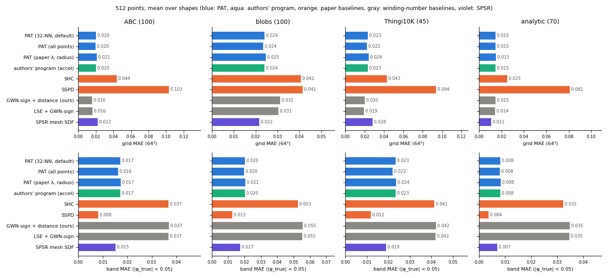
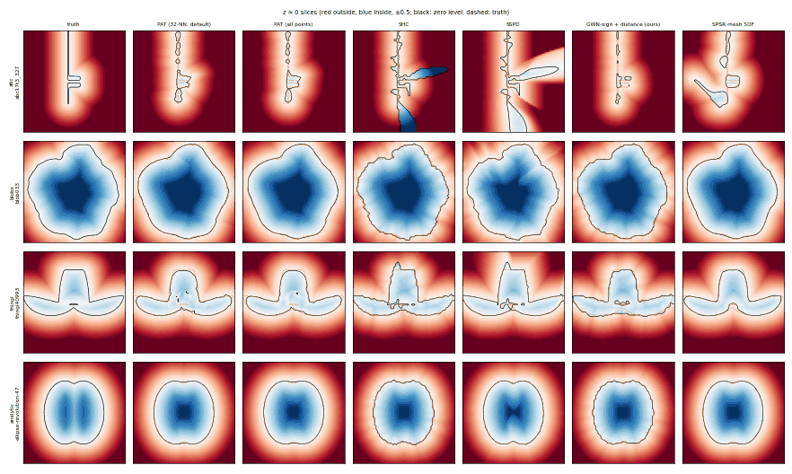
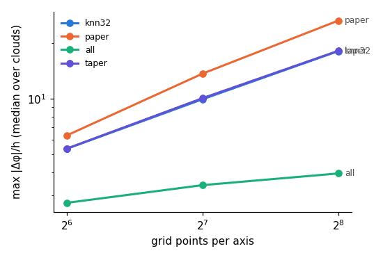
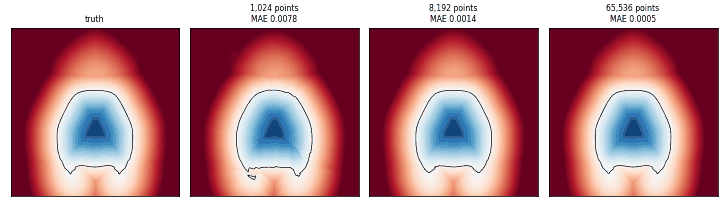

# Points as Tori: evaluation (WP14)

This is the accuracy evaluation of SPEC.md §16.2–16.4 and the studies that §18 asks for: the
GWN-sign baseline, narrow-band error and eikonality, the sign rule, continuity per evaluation rule,
orientation, and density. The paper is Feng, Gkioulekas, Crane, "Points as Tori", SIGGRAPH 2026,
Sec. 5.2, Figs. 7, 17–19, 27 and 29.

Every number here comes from the CPU path. The GPU was held by WP10's training run, so the TF32
measurement is deferred. The machine was shared throughout: other agents' jobs and the training run
were active, and from the middle of the run our own jobs were capped at 24–32 threads at nice 19.
Timings therefore carry that load. Accuracy numbers do not depend on it, because every pipeline is
deterministic.

**Status.** Complete: the 315-shape accuracy run (all methods), the sign-rule study, the §16.3
sweep, the black-box comparison (`COMPARISON.md`), the continuity study (32 clouds) and Fig. 7.
Partial: Fig. 29 (110k and 880k points; 7.3M is running) and orientation (running). These sections say what they cover and
will be extended. Everything is reproducible with `scripts/pat_eval.sh`.

## Recommendations for the user

These are recommendations only; no crate default was changed.

1. **Sign rule: make `SignRule::Geometric` the default.** It is never worse in our runs and is
   strictly better wherever the network predicts a saddle torus: grid MAE drops by 31 %, 27 %, 48 %,
   2 % and 0.1 % on the 5 such clouds (arc-revolution-10 at 512 and 2048 points,
   ellipse-revolution-47, moon-revolution-55, full femur). Elsewhere it is bitwise identical to
   `Reference`. The decision carries little weight with the released weights, though: the network
   almost never predicts a saddle. Over all 378 clouds (258,478 points) there are 51 saddle tori, 38
   of them on the golden holey-bunny/femur/snail clouds, and none on tori with 35–69 % saddle
   area. The rule
   will matter for retrained weights (WP10): train and evaluate a `Geometric` model. Evidence:
   "Sign rule" below.
2. **Evaluation rule: keep 32-NN `PerQuery` as the fast default, and offer `All` (or, better, a
   subsampled far field) as the accuracy option.** `All` is better on every criterion we measured:
   grid MAE 0.0201 vs 0.0207, band MAE 0.0164 vs 0.0170, eikonality 0.028 vs 0.040, catastrophic
   failures 20 vs 22, max |Δφ|/h at 256³ of 4.2 vs 17 (median), and zero-level components at 256³
   of 33 vs 91 on 27 clouds with 37 true components (detached: 2 vs 20). It costs O(n) per query (4.4× the 32-NN grid time at 512
   points). Do **not** adopt the paper's λ = 10³/D with radius 2C/λ: it is worst on every criterion
   (eikonality 0.054; 328 zero-level components, 177 detached, where the truth has 37). Do **not** adopt the tapered
   kNN: it changes nothing measurable (see "Continuity").
3. **C: 32 is at least as good as 64** in the §16.3 sweep (MAE 0.0213 vs 0.0218, eikonality 0.039
   vs 0.046); `All` with C = 32 is best overall (MAE 0.0209, eikonality 0.030). The differences are
   within about one standard error on MAE but consistent on eikonality. Worth a decision together
   with the evaluation rule; k = 16/32/64 makes no difference.
4. **Be explicit about the comparison with "GWN-sign + distance".** On the paper's own metric (grid
   MAE over the 64³ box) PAT does **not** beat it overall (0.0207 vs 0.0211, a tie). It loses on ABC
   (0.0203 vs 0.0160) and Thingi10K (0.0231 vs 0.0199), wins on blobs (0.0242 vs 0.0313) and ties on
   the analytic set. Near the surface PAT is much better: band MAE 0.0170 vs 0.0431, better on 309
   of 315 shapes, and eikonality 0.040 vs 0.131. PAT also has twice the catastrophic sign failures
   (22 vs 11). GWN-sign + distance is nearest-point distance, so its zero set is a union of small
   spheres, useless for contouring. The grid mean alone favors it because most grid points are far
   from the surface.

## Protocol

**Clouds.** 512 points per shape, sampled uniformly by area (`sample_mesh_uniform`, face normals,
seeded by the shape's name). Meshes are first centered at their vertex mean and scaled so the
largest |coordinate| is 1 (`center_and_scale`). Analytic shapes are sampled by
`Solid::sample_surface` with exact normals, as defined (App. E parameters keep them inside
[−1, 1]³). Every method sees the same cloud, including the authors' program.

**Grid and truth.** The grid is 64³ points, `linspace(−1, 1, 64)` per axis (the golden grid). The
truth is the exact mesh SDF (`truth::MeshTruth`: BVH closest point; sign by the exact winding number
up to 20k faces, Barill's FWN with β = 2 above) or the exact analytic SDF.

**Metrics.** Each is computed per shape, then averaged over the shapes of a dataset:
- *grid MAE*: mean |φ − φ_true| over the 64³ grid, the paper's ε(φ);
- *band MAE*: the same, restricted to grid points with |φ_true| < 0.05 (about 1.6 grid cells);
- *eikonality*: mean | ‖∇_h φ‖ − 1 | over the interior grid points, with ∇_h central differences on
  the grid. The operator is the same for every method, so methods without a gradient compare fairly.
  A sign flip with no zero crossing, as in nearest-point distance signed by a winding number, shows
  up here;
- *catastrophic failure*: more than 1 % of the grid points with |φ_true| > 0.05 have the wrong sign.
  This definition is ours; the paper uses the term without defining it. We also count shapes with a
  grid MAE above 0.05.

**Methods.**

| label | definition |
|---|---|
| PAT 32-NN (default) | crate defaults: the authors' weights, `SignRule::Reference`, 32-NN, `PerQuery` λ = 64/σ_x (= the authors' `accelerate=True`) |
| PAT all points | same tori, Eq. 25 over all points (= `accelerate=False`) |
| PAT paper λ + radius | Sec. 4.2 as printed: λ = 10³/D, radius 2C/λ, 32-NN fallback (`TorusField::paper_options`) |
| PAT tapered 32-NN (ours) | `examples/eval_util/util.rs::TaperField`: weights × (1 − (ρ/ρ₃₃)²)², continuous across kNN swaps. Example code, not in the crate |
| PAT Geometric | `SignRule::Geometric` tori (WP1 resolution 1), 32-NN or all |
| authors' program | the authors' `PointsAsTori(points, normals).signed_distance(G, accelerate=…)`, CPU JAX, on the same clouds (`scripts/pat_eval_ref.py`) |
| SHC, SSPD | Eq. 28, 29 with Barill point areas (k = 20) and the PAT neighbor rule (32-NN, λ = 64/σ_x). SHC's exact w = 0 is set to 0 and counted: 22 grid points in all |
| GWN-sign + distance (ours) | distance to the nearest cloud point, signed by the direct GWN at ½ (WP5 resolution 3) |
| RWN(0.02)-sign + distance | the same with Chen et al.'s regularized winding number, ε = 0.02 (the paper's Fig. 8). Equal to GWN-sign to 4 digits everywhere, so omitted from the tables below (in `report/tables.md`) |
| LSE + GWN-sign | LogSumExp soft-min distance (same neighbors and λ), signed by the GWN |
| SPSR mesh SDF | Open3D screened Poisson, depth 6 (= 64³), single thread, no trimming (`scripts/pat_spsr.py`); exact distance to its mesh, signed by its winding number |

SHM and NN-VIPSS are not run (SPEC §9). Rows for retrained weights are a placeholder (see below).

### Datasets and the train/test overlap

| dataset | shapes | source | seen in training? |
|---|---|---|---|
| ABC | 100 | 20 from `ABC0_validation_0.npz` and `ABC17_validation_3.npz`, plus 80 seeded picks from `nice/ABC*_train_mode0_*.npz` (`scripts/pat_eval_data.py`, seed 14; 8 picks rejected as non-manifold) | **18 unseen, 2 exact duplicates of training shapes, 80 seen**, reported separately below |
| blobs | 100 | our blob generator (WP8; seed 14014, items 0–99) | unseen by construction: our own Perlin permutation, so the noise fields differ from the authors' |
| Thingi10K | 45 | `data/thingi10k/converted/`, selected by `eval prepare thingi` (see below) | unseen (the network was trained on ABC and blobs only) |
| analytic | 70 | App. E set (WP8, seeds 0–69) | unseen |
| reference `data/` | 3 | block, knot, femur meshes (WP5's extraction), resampled at 512 points | unseen |

*Overlap.* SPEC §16.2's "100 ABC shapes not seen in training" cannot be met with the shipped data.
The test splits of chunks 2/17/55/58 are not shipped. We fingerprinted all 22,457 training shapes
(`nice/` and `simulated/`; exact: sorted vertex coordinates rounded to 1e-6). Two of the 20
validation shapes are exact copies of training shapes: `abc0val_3` = `nice/ABC2_train_mode0_4.npz:205`
and `abc17val_0` = `nice/ABC17_train_mode0_1.npz:131` (`runs_tmp/pat-wp14/src/overlap.json`). Two
more (`abc17val_3`, `abc17val_5`) share face count, area and volume to 3 digits with hundreds of
training shapes; these are generic primitives, not copies. The paper attributes PAT's ABC advantage
to "our network was mostly trained on other ABC shapes". On our data, the 18 unseen and the 80 seen
ABC shapes give the same PAT error (0.0215 vs 0.0203, within one s.e.).

*Thingi10K selection.* We start from our manifold conversion (`converted.tsv` status `kept`, no
boundary) and keep a file only if:
- the dataset's `geometry_data.csv` lists the raw file with 0 self-intersections, vertex- and
  edge-manifold, oriented, no boundary, no degenerate or duplicated faces;
- it has 1,000–40,000 faces;
- its licence allows modified renders (CC BY, CC BY-SA, public domain).

That leaves 1,978 candidates. A seeded shuffle (seed 45) orders them. Each is then checked by
`truth::check_mesh` (closed, consistently oriented, positive volume, no degenerate faces),
`ddg_core::TriMesh::new`, and our own self-intersection test, in order, until 45 pass. The test
(`util::self_intersections`, also `eval selfint <obj>`) uses a uniform grid on the triangle boxes and
looks for proper crossings of an edge through another face (orientation determinants with a 1e-14
relative dead zone, so touching contacts do not count) and for folded edges (dihedral angle ≈ 0).
Checked against the dataset's own counts, it finds exactly 2 crossings on each of five meshes listed
with 2 self-intersections (276681, 42998, 55427, 72948, 780015), and 7 folds on 99896 (listed with 43,
mostly coplanar overlaps). One candidate was rejected (106789: a degenerate face). The ids, authors
and licences are listed under "Credits".

## Accuracy (Fig. 18 analogue)



**grid MAE** (mean over shapes)

| method | ABC (100) | blobs (100) | Thingi10K (45) | analytic (70) | all 315 |
|---|---|---|---|---|---|
| PAT 32-NN (default) | 0.0203 | 0.0242 | 0.0231 | 0.0146 | 0.0207 |
| PAT all points | 0.0195 | 0.0235 | 0.0223 | 0.0147 | 0.0201 |
| PAT paper λ + radius | 0.0211 | 0.0246 | 0.0240 | 0.0149 | 0.0212 |
| authors' program (accel) | 0.0203 | 0.0242 | 0.0231 | 0.0146 | 0.0207 |
| SHC | 0.0438 | 0.0407 | 0.0430 | 0.0250 | 0.0385 |
| SSPD | 0.1032 | 0.0415 | 0.0940 | 0.0808 | 0.0773 |
| GWN-sign + distance (ours) | 0.0160 | 0.0313 | 0.0199 | 0.0145 | 0.0211 |
| LSE + GWN-sign | 0.0160 | 0.0305 | 0.0190 | 0.0143 | 0.0207 |
| SPSR mesh SDF | 0.0222 | 0.0217 | 0.0280 | 0.0106 | 0.0203 |

Standard errors of the PAT means: 0.0010 (ABC), 0.0015 (blobs), 0.0015 (Thingi), 0.0008 (analytic).
The other rows are similar except SHC/SSPD (0.003–0.017). Per dataset and method, with medians:
`runs_tmp/pat-wp14/report/tables.md`.

**band MAE** (|φ_true| < 0.05)

| method | ABC | blobs | Thingi10K | analytic | all 315 |
|---|---|---|---|---|---|
| PAT 32-NN (default) | 0.0171 | 0.0203 | 0.0233 | 0.0082 | 0.0170 |
| PAT all points | 0.0162 | 0.0199 | 0.0220 | 0.0080 | 0.0164 |
| PAT paper λ + radius | 0.0173 | 0.0205 | 0.0235 | 0.0083 | 0.0172 |
| SHC | 0.0368 | 0.0527 | 0.0413 | 0.0323 | 0.0415 |
| SSPD | 0.0081 | 0.0126 | 0.0118 | 0.0036 | 0.0091 |
| GWN-sign + distance (ours) | 0.0370 | 0.0555 | 0.0422 | 0.0348 | 0.0431 |
| LSE + GWN-sign | 0.0368 | 0.0553 | 0.0420 | 0.0346 | 0.0429 |
| SPSR mesh SDF | 0.0152 | 0.0172 | 0.0189 | 0.0070 | 0.0145 |

**eikonality** (mean | ‖∇_h φ‖ − 1 |)

| method | ABC | blobs | Thingi10K | analytic | all 315 |
|---|---|---|---|---|---|
| PAT 32-NN (default) | 0.034 | 0.055 | 0.055 | 0.015 | 0.040 |
| PAT all points | 0.025 | 0.039 | 0.038 | 0.011 | 0.028 |
| PAT paper λ + radius | 0.048 | 0.072 | 0.075 | 0.022 | 0.054 |
| SHC | 0.434 | 0.464 | 0.525 | 0.189 | 0.402 |
| SSPD | 0.289 | 0.197 | 0.327 | 0.146 | 0.233 |
| GWN-sign + distance (ours) | 0.090 | 0.209 | 0.117 | 0.086 | 0.131 |
| LSE + GWN-sign | 0.100 | 0.213 | 0.125 | 0.096 | 0.139 |
| SPSR mesh SDF | 0.013 | 0.015 | 0.017 | 0.007 | 0.013 |

**catastrophic failures**: wrong sign on more than 1 % of the off-surface grid; in brackets, grid
MAE > 0.05

| method | ABC | blobs | Thingi10K | analytic | all 315 |
|---|---|---|---|---|---|
| PAT 32-NN (default) | 6 (3) | 9 (4) | 6 (1) | 1 (0) | 22 (8) |
| PAT all points | 6 (2) | 8 (4) | 6 (1) | 0 (0) | 20 (7) |
| PAT paper λ + radius | 6 (3) | 10 (5) | 6 (1) | 1 (0) | 23 (9) |
| SHC | 48 (20) | 48 (25) | 32 (11) | 13 (4) | 141 (60) |
| SSPD | 48 (75) | 48 (34) | 32 (33) | 13 (38) | 141 (180) |
| GWN-sign + distance (ours) | 0 (2) | 9 (7) | 2 (0) | 0 (0) | 11 (9) |
| LSE + GWN-sign | 0 (2) | 9 (7) | 2 (0) | 0 (0) | 11 (9) |
| SPSR mesh SDF | 6 (6) | 0 (7) | 6 (5) | 0 (0) | 12 (18) |

The authors' program gives exactly the PAT rows: the same means to 4 digits and the same failure
counts (`COMPARISON.md`).

**Per-shape comparisons** (grid MAE; the number of shapes where the first is lower)

| dataset | PAT < GWN-sign | PAT < LSE+GWN | PAT < SPSR | PAT < SHC | PAT-all < PAT |
|---|---|---|---|---|---|
| ABC | 21/100 | 26/100 | 31/100 | 79/100 | 59/100 |
| blobs | 88/100 | 88/100 | 17/100 | 100/100 | 92/100 |
| Thingi10K | 12/45 | 12/45 | 12/45 | 41/45 | 37/45 |
| analytic | 25/70 | 29/70 | 7/70 | 50/70 | 23/70 |

Band MAE: PAT < GWN-sign on 97/100, 100/100, 42/45, 70/70 shapes. Eikonality: PAT < GWN-sign on 77,
100, 36, 66.

**Reading.**
- **Against the paper's baselines,** PAT beats SHC and SSPD by a wide margin, as the paper says:
  grid MAE half of SHC's, 141 vs 22 catastrophic failures. SSPD has the lowest band error of all
  methods, but its tangent-plane sign fails away from the surface.
- **Against SPSR:** the mesh pipeline is lower on blobs and the analytic set, higher on ABC and
  Thingi10K. The paper reports SPSR lower on 3 of 4 datasets, PAT lower on ABC. We agree on ABC and
  differ on Thingi10K, whose selection differs from the paper's. SPSR is the best method near the
  surface and in eikonality (it is an exact mesh SDF), but it fails catastrophically on thin CAD
  parts (6 on ABC, 6 on Thingi10K).
- **Against the GWN-signed nearest-point distance** (ours): see Recommendation 4. It wins the grid
  mean on CAD-like shapes (ABC, Thingi10K) and loses badly near the surface everywhere. On blobs
  (smooth, 512 points sparse relative to the features) PAT wins on every criterion.
- **PAT's catastrophic failures** are mostly thin CAD plates and blobs with thin necks, where
  neighborhoods see both sides. Examples: Thingi 509310, 10.8 % wrong sign (GWN-sign 0.3 %); ABC
  `abc17t2_48`, 9.1 % (GWN-sign 0.07 %); `abc0val_6`, 5.4 %. On 17 shapes only PAT fails, on 6 only
  GWN-sign, on 5 both.
- **ABC by training status:**

| ABC subset | PAT | PAT all | GWN-sign | LSE+GWN | SPSR | SHC |
|---|---|---|---|---|---|---|
| unseen (18) | 0.0215 | 0.0205 | 0.0143 | 0.0144 | 0.0239 | 0.0393 |
| exact duplicates of training shapes (2) | 0.0100 | 0.0106 | 0.0046 | 0.0090 | 0.0094 | 0.0184 |
| seen (80) | 0.0203 | 0.0195 | 0.0166 | 0.0166 | 0.0222 | 0.0454 |

- **Reference `data/` clouds** at 512 points (grid MAE). block: PAT 0.0321, GWN-sign 0.0308,
  SPSR 0.0261. knot: 0.0126, 0.0181, 0.0083. femur: 0.0058, 0.0047, 0.0048. The full golden clouds
  (1,024–3,897 points, `cases/reffull`) reproduce WP5's sanity table to 4 digits.

Slices (Fig. 17 analogue; z = 0, one shape per dataset, red outside, blue inside; black is the zero
level of the method, dashed the truth):



### Retrained row (placeholder for WP10)

The `case` stage takes extra models:

```
RETRAINED="--retrained retrained=data/points-as-tori/retrained-reference.safetensors \
           --retrained retrained-geo=data/points-as-tori/retrained-geometric.safetensors:geometric" \
  crates/ddg-points-as-tori/scripts/pat_eval.sh case report
```

`label=path` loads the safetensors with `Model::from_safetensors`, builds with the default options
(append `:geometric` for weights trained with `SignRule::Geometric`) and adds a `label` row to every
table. `pat_eval_report.py` picks up any method whose name starts with `retrained`. Per SPEC §18 /
WP4 resolution 1, this comparison uses CPU (f32-accurate) inference. **Not yet run:** no retrained
weights exist yet.

## Sign rule (Reference vs Geometric)

Sets: WP8's saddle-rich shapes (tori, rings, washer; saddle area fraction 7–69 %) and the 13 App. E
instances with saddle regions, each at 512 and 2048 points, plus the four standard datasets.

| set | shapes | saddle tori predicted | Geometric better | Reference better | mean ΔMAE (Geo − Ref) |
|---|---|---|---|---|---|
| ABC / blobs / Thingi10K / ref | 248 | 0 | 0 | 0 | 0 (bitwise equal fields) |
| analytic (70) | 70 | 4 | 1 | 0 | −4.0e-5 |
| saddle set, 512 / 2048 | 11 / 11 | 0 / 0 | 0 | 0 | 0 |
| App. E saddle 13, 512 | 13 | 4 | 1 | 0 | −2.2e-4 (arc-revolution-10: 0.0092 → 0.0064) |
| App. E saddle 13, 2048 | 13 | 5 | 3 | 0 | −1.3e-4 (ellipse-revolution-47: 0.0019 → 0.0010) |

With `All` the result is the same (Geometric better on the same shapes, never worse).

**Why the rule rarely matters: the network almost never predicts a saddle, or any anisotropy.**
`eval curv` compares the network's principal curvatures (`fit_diagnostics`) with the exact ones of
the solid at every input point:

| shape (512 points) | true saddle fraction | predicted saddle fraction | at true saddles: true (κmin σ, κmax σ) | predicted |
|---|---|---|---|---|
| torus (R .5, r .25) | 0.355 | 0 | (−0.45, 1.15) | (−0.42, −0.45) |
| thin torus | 0.414 | 0 | (−0.27, 1.80) | (−0.86, −0.92) |
| moon ring | 0.686 | 0 | (−1.05, 0.59) | (−0.43, −0.48) |
| lens ring | 0.270 | 0 | (−0.78, 0.67) | (−0.23, −0.26) |
| tall-ellipse ring | 0.447 | 0 | (−0.61, 0.34) | (−0.68, −0.75) |

The 2048-point clouds and the App. E saddle shapes behave the same: 0–0.15 % predicted against
4–69 % true (`runs_tmp/pat-wp14/curv_summary.txt`, `logs/curv.log`). The sign conventions differ
(truth: convex positive; fit: convex negative), but the saddle test is the sign of the product, which
does not depend on the convention.

Over **all** points of the 70 App. E shapes, the predicted anisotropy |κmin|/|κmax| has a median of
0.89–0.95 on every shape, including cylinders and extrusions, where the true value is 0. The authors'
own golden tori agree: 97.6–100 % are spindle tori (R < |r|), and 81–100 % have R < |r|/4. These are
nearly spheres of radius |r| ≈ 1.3–7σ. Spot gives median R/σ 0.2–1.5 against |r|/σ 2–14
(Fig. 7 run). **With the released weights the tori are essentially osculating-ish spheres.** The
paper's anisotropic torus model is barely used. It still works, because the blend of many
sphere-like pieces is accurate near the surface. This is a property of the authors' weights (our
coefficients equal theirs to 3e-6), and it is a question for the retraining (WP10): does a retrained
network use anisotropy and saddles? If it does, the sign rule matters, and Geometric is the
geometrically correct one (WP2's `pat-fit-contact`).

## §16.3 choices (first 50 ABC + 50 blob shapes)

| variant | grid MAE (± s.e.) | band MAE | eikonality | catastrophic |
|---|---|---|---|---|
| C 64, k 32 (default) | 0.0218 ± 0.0014 | 0.0186 | 0.046 | 10 |
| C 32 | 0.0213 ± 0.0013 | 0.0184 | 0.039 | 10 |
| C 128 | 0.0221 ± 0.0014 | 0.0187 | 0.051 | 10 |
| k 16 | 0.0218 ± 0.0014 | 0.0187 | 0.047 | 10 |
| k 64 | 0.0217 ± 0.0013 | 0.0185 | 0.043 | 10 |
| paper λ = 10³/D, radius 2C/λ | 0.0224 ± 0.0014 | 0.0188 | 0.061 | 10 |
| all, C 64 | 0.0209 ± 0.0013 | 0.0179 | 0.033 | 9 |
| all, C 32 | 0.0209 ± 0.0012 | 0.0175 | 0.030 | 8 |
| all, C 128 | 0.0215 ± 0.0013 | 0.0183 | 0.039 | 10 |
| tapered 32-NN | 0.0218 ± 0.0014 | 0.0186 | 0.046 | 10 |

Smaller C (a smoother blend) helps a little and consistently. The paper's Fig. 17 caption says the
same ("better results using smaller λ"). The orientation ε was swept by WP9a (flat over 0.25–4/σ;
NOTES-WP9a) and is not repeated here. The tracer `safety` is a timed study for WP16 and was not
measured here.

## Continuity per evaluation rule (WP6 resolution 1)

The cloud set: 32 in all. The 12 golden clouds (512–12,917 points; truth for 8 of them) and 5 shapes
at 512 points from each of ABC (unseen validation shapes), blobs, Thingi10K and the analytic set.
Each is evaluated at 64, 128 and 256³. `All` at 256³ was skipped for the 3 clouds with more than
2048 points (cost).

For each rule, on grids `linspace(−1, 1, n)³`, we measure:
- the jump statistic: |Δφ|/h along every grid edge, as max, p99.9, and the fraction of edges above 5;
- error and eikonality;
- the closed components of the zero level set, extracted by our marching cubes (dense, box ±1.1),
  compared with the truth meshed the same way. A component is *detached* if none of its vertices lies
  within 2h of the true surface.

At 256³, on the 27 clouds that have a truth and all four rules:

| rule | max |Δφ|/h (median / worst) | p99.9 | edges > 5 (‰) | eikonality | MAE | band MAE | MC components (truth: 37) | detached |
|---|---|---|---|---|---|---|---|---|---|
| 32-NN `PerQuery` (default) | 17.4 / 68.9 | 2.09 | 0.60 | 0.039 | 0.0145 | 0.0130 | 91 | 20 |
| paper λ + radius | 26.2 / 133.0 | 4.72 | 1.53 | 0.066 | 0.0149 | 0.0132 | 328 | 177 |
| all points | 4.2 / 24.1 | 1.21 | 0.10 | 0.024 | 0.0143 | 0.0126 | 33 | 2 |
| tapered 32-NN (ours) | 17.5 / 71.0 | 2.13 | 0.61 | 0.039 | 0.0145 | 0.0130 | 94 | 21 |

The median max slope grows like 1/h for the kNN rules (4.9 → 9.8 → 17.4 at 64/128/256) and much
more slowly for `All` (2.8 → 3.8 → 4.2). Detached components at 64/128/256: 32-NN 9/19/20, paper
16/50/177, all 3/4/2, taper 9/17/21. Extra components appear on thin CAD plates and Thingi models;
for example `thingi117647` (truth 1) gets 8 with 32-NN, 48 with the paper rule, 1 with `All`.
Per-cloud tables: `runs_tmp/pat-wp14/report/tables.md`.

**Mechanism: the orchestrator's hypothesis (far-field kNN swaps) is refuted as the cause of the large
slopes.** Three measurements:
1. *The steepest edges are continuous.* For the 40 steepest edges of each of the 32 clouds at 256³,
   we bisected φ along the edge 50 times. On every edge of every cloud, for both the kNN and the
   radius rule, the remaining difference is ≤ 2e-13, so there is no discontinuity. On 30 of 32 clouds
   the neighbor set is the same at both ends of every one of these edges (holey-bunny 25 % differ,
   one other cloud 2.5 %). They lie mostly in the far field (median ρ_min/σ_x 0.6–1.9 per cloud;
   median |φ_true| 0.005–0.5).
2. *The real kNN-swap jumps are small.* `eval swaps` samples 20,000 random edges of the 256³ grid.
   On each of the 5,500–13,500 edges whose 32-NN set changes, it bisects to the swap (1e-13) and
   measures |φ⁺ − φ⁻|:

   | cloud | n | swaps sampled | max jump | median | max jump / h |
   |---|---|---|---|---|---|
   | femur | 3897 | 9603 | 1.4e-3 | 2.5e-5 | 0.18 |
   | holey-bunny | 12917 | 13468 | 6.9e-4 | 2.6e-7 | 0.09 |
   | snail | 4096 | 11160 | 6.9e-4 | 2.8e-9 | 0.09 |
   | ABC0_6 | 1024 | 7226 | 6.5e-6 | 2e-14 | 0.001 |
   | 512-pt ABC, blob, Thingi, analytic | 512 | 5474–6316 | 1.3e-7 … 3.2e-4 | ~1e-14 … 8e-9 | ≤ 0.04 |

   With λ_xσ_x = C = 64, the entering or leaving point (the farthest of the set, at ρ = 2σ_x) has
   relative weight e^{−C(2 − ρ_min/σ_x)}. That is tiny unless every neighbor is nearly equidistant
   (ρ_min/σ_x → 2), which happens only far from dense clouds (femur's swaps: median ρ_min/σ_x = 1.95).
   So the "all 32 weights similar in the far field" picture holds only there, and even there the
   jumps are ≤ 1.4e-3. The radius rule has jumps up to 1.5e-3 where its set changes or falls back.
3. *The steep parts are transitions of width ≈ 1/λ_x = σ_x/C.* `eval profile` samples φ at 4,001
   points along the steepest edges. The 10–90 % width of the change is 1.1–2.2 × (1/λ_x) for 32-NN
   (1/λ_x = 2.4–5.6e-3). Steepest sampled slopes are 26–90, against grid slopes of 19–60. For `All`,
   1/λ_x is 3–4× larger (σ_x is half the cloud diameter), so the same transitions spread over more
   than a grid cell. These are places where the soft arg-min over data points moves from one group
   of points to another whose tori disagree by Δg ≈ 0.05–0.5: slope ≈ λ_x Δg. The slope keeps
   growing like 1/h until h < 1/λ_x, which is why it looks like a jump on practical grids. With the
   released weights the tori are near-spheres (see "Sign rule"), so neighboring pieces disagree away
   from the surface.

**Consequences.**
- The tapered kNN (continuous by construction) changes nothing measurable: same slopes, error,
  components and eikonality. We do not recommend it.
- What helps is a **smaller λ in the far field**: `All` (σ_x global) or C = 32. Both cut the spurious
  components (91 → 33 at 256³, truth 37; detached 20 → 2) and the slopes.
- The paper's constant λ = 10³/D is the extreme case, with λ much larger than C/σ_x far away. It is
  the worst rule: 89 components.
- §8.6's Lipschitz bound really is only a heuristic. Slopes up to ~100 occur with the default rule,
  and WP6's growth rule is what keeps marching cubes correct.



## Orientation (Fig. 27; WP9a resolution 1)

*Queued (runs after the continuity study under the thread cap): 41 clouds (WP9a's 11, plus 10 ABC,
10 blob and 10 Thingi10K shapes at 2048 points), 30 % flipped, 10 and 30 iterations
(`eval orient`).*

## Density (§16.4)

**Fig. 7 analogue.** Spot (Keenan Crane, CC0; `data/models/spot/spot/spot_triangulated.obj`,
5,856 faces), uniform samples, default PAT, 128³ grid over [−1, 1]³:

| points | grid MAE | band | interior (φ_true < −0.05) | exterior | eikonality | R/σ median | |r|/σ median |
|---|---|---|---|---|---|---|---|
| 1,024 | 0.00779 | 0.00649 | 0.00542 | 0.00821 | 0.015 | 0.2 | 2.1 |
| 8,192 | 0.00138 | 0.00089 | 0.00080 | 0.00150 | 0.007 | 0.5 | 6.0 |
| 65,536 | 0.00048 | 0.00021 | 0.00043 | 0.00051 | 0.006 | 1.5 | 14.0 |

The paper shows 0.00964 / 0.00685 / 0.00627 on its shape. Accuracy improves with sampling, as the
paper says, and faster here: spot is smooth.



**Fig. 29 analogue** (partial). The densest usable mesh is Thingi10K 59340, "GOYLE" by fong182
(CC BY-SA; 786,432 faces, closed, one component, 0 self-intersections). David is not available.
128³ grid; marching cubes at 256³:

| points | grid MAE | band | interior | exterior | interior / exterior |
|---|---|---|---|---|---|
| 110,000 | 0.00092 | 0.00033 | 0.00355 | 0.00021 | 17× |
| 880,000 | 0.00051 | 0.00008 | 0.00222 | 0.00006 | 37× |
| 7,300,000 | *running (about 3 h at 12 threads)* | | | | |

The paper's observation is reproduced in relative terms: the interior error is an order of magnitude
above the exterior error, and the ratio grows with density. In absolute terms the interior still
improves from 110k to 880k. Whether it gets worse at 7.3M (the paper's "paradoxically worse") is what
the running job will show. 29M points was not attempted (about 4 h of CPU network time under the
current cap; WP16 or GPU).

## GPU TF32 vs Split3 (WP4 resolution 1)

Not measured: the training run held the GPU during WP14. The `eval gpu <case>...` subcommand (build
with `--features cuda`) compares CPU, `GpuMatmul::Tf32` and `Split3` coefficients and φ (32-NN and
all) on the 64³ grid, plus each one's grid MAE, and writes `<case>/gpu.json`. For WP16.

## Reproduction

```
export CARGO_TARGET_DIR=$PWD/target-pat14
JOBS=6 THREADS=4 crates/ddg-points-as-tori/scripts/pat_eval.sh      # all stages
```

Stages: `data` (`pat_eval_data.py`), `prepare`, `spsr`, `ref` (the authors' program; see
COMPARISON.md), `case`, `continuity`, `orient`, `density`, `report`. The per-case outputs are in
`runs_tmp/pat-wp14/cases/<dataset>/<case>/` (`result.json`, `slices.npy`, `continuity.json`, …), and
the tables in `runs_tmp/pat-wp14/report/tables.md`. Extra studies: `eval swaps`, `eval profile` and
`eval curv` on a case directory, and `eval selfint <obj>`.

## Credits

Thingi10K (Zhou and Jacobson 2016); each model is under the licence its author chose. The 45 models
of the evaluation:

| id | model | author | licence | faces | components |
|---|---|---|---|---|---|
| 38741 | Snowflake | JonMonaghan | CC Attribution | 2208 | 1 |
| 40993 | Creatures of Thingiverse | hlbrosnihan | CC Attribution - Share Alike | 12898 | 1 |
| 41984 | Functional Differential Gear System | Thing-O-Fun | CC Attribution - Share Alike | 3138 | 1 |
| 49167 | Tri-Track dual servo robot tank chassis | Ktronics | CC Attribution - Share Alike | 1132 | 1 |
| 49544 | Kindle Fire Handle | dougc314 | CC Attribution - Share Alike | 6266 | 1 |
| 56954 | Kazoo | wes | CC Attribution - Share Alike | 4060 | 1 |
| 58938 | MakerBot Wizard | wes | CC Attribution | 14834 | 1 |
| 59936 | Mini Rover | Kepler | CC Attribution | 9300 | 1 |
| 61039 | Actin Protein Structure | destroyer2012 | CC Attribution - Share Alike | 15290 | 2 |
| 62287 | 60s Sofa | PrettySmallThings | CC Attribution | 3368 | 1 |
| 63244 | GarabatoBOT (DoodleBOT) | MAF | CC Attribution | 1052 | 1 |
| 72613 | Lightcycle Model Kit | cbabbage | CC Attribution | 2624 | 1 |
| 73736 | A Dodecahedron Speaker for Desktop Printers | seanmichaelragan | CC Attribution | 2388 | 1 |
| 75098 | Robots | Oblomobka | CC Attribution - Share Alike | 20610 | 1 |
| 75282 | the Addalock | Mr_MegaTronic | CC Attribution | 4420 | 3 |
| 76291 | Magic Block Piercing Trick | dnewman | CC Attribution - Share Alike | 1660 | 1 |
| 77014 | Lynx Building Toy | OSTycoon | CC Attribution | 4294 | 1 |
| 79193 | Automaton Hand | MakerBot | CC Attribution | 30066 | 1 |
| 80354 | PIXAR's Luxo Jr. | Mattraptions | CC Attribution - Share Alike | 10796 | 1 |
| 87395 | Sugru Fixbot | mikevanis | CC Attribution - Share Alike | 1392 | 1 |
| 91611 | Simple Adjacent Line Tool | Halodine | CC Attribution - Share Alike | 5348 | 1 |
| 94153 | Shack Bot | MakerBot | CC Attribution | 18760 | 1 |
| 97729 | Universal bottle cap tripod | Camos | CC Attribution - Share Alike | 2582 | 1 |
| 103538 | Gunny Sacks | BenitoSanduchi | CC Attribution - Share Alike | 24752 | 1 |
| 107587 | Advent Calendar | pleppik | CC Attribution | 22282 | 1 |
| 109772 | Advent Calendar | pleppik | CC Attribution | 5288 | 1 |
| 117647 | 3d Print - Avocado Pit Germination Holder - Cup Edition | sa7ina | CC Public Domain Dedication | 1536 | 1 |
| 119918 | Truck V1 | reza | CC Attribution - Share Alike | 4626 | 1 |
| 128482 | Spin Top | mariothemagician | CC Attribution - Share Alike | 1888 | 1 |
| 153951 | RasPi Case | MakerBot | CC Attribution | 1630 | 1 |
| 162575 | Fennec Fox | Physics_Dude | CC Attribution | 1026 | 4 |
| 178197 | Turbine Rotary Tool 60000 rpm | RichMac | CC Attribution | 3804 | 2 |
| 178201 | Turbine Rotary Tool 60000 rpm | RichMac | CC Attribution | 11122 | 1 |
| 238413 | Traxbot - an EZ-robot build | infinityplusplus | CC Attribution - Share Alike | 1332 | 1 |
| 250042 | Wheeled Inchworm | someandy | CC Attribution - Share Alike | 3704 | 2 |
| 462523 | 41 Piece Spirograph | Hercemer | CC Attribution - Share Alike | 3336 | 1 |
| 472053 | 4-8-8-4 Big Boy Locomotive | MakerBot | CC Attribution | 12234 | 1 |
| 472093 | 4-8-8-4 Big Boy Locomotive | MakerBot | CC Attribution | 15406 | 1 |
| 472101 | 4-8-8-4 Big Boy Locomotive | MakerBot | CC Attribution | 14596 | 1 |
| 472174 | 4-8-8-4 Big Boy Locomotive | MakerBot | CC Attribution | 14526 | 1 |
| 509310 | Catalan Wireframe Polyhedra | mathgrrl | CC Attribution - Share Alike | 11520 | 1 |
| 550964 | Famous Paris buildings | LeFabShop | CC Attribution - Share Alike | 6156 | 1 |
| 700904 | A useful 3D-printed tripod (1/4-20 screw reqd) - UPDATED (July 31; 2014) | cmceezee | CC Attribution - Share Alike | 2674 | 1 |
| 1436278 | 3D-printable sand play set | CreativeTools | CC Attribution - Share Alike | 18610 | 1 |
| 1514498 | Vienna Giant Wheel (Riesenrad) | stylesuxx | CC Attribution - Share Alike | 4560 | 15 |
| 59340 | GOYLE (Fig. 29 only) | fong182 | CC Attribution - Share Alike | 786432 | 1 |

Spot is by Keenan Crane (CC0). The ABC models are from Koch et al. 2019, as shipped in the authors'
training data.
