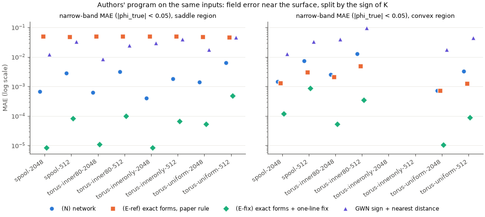
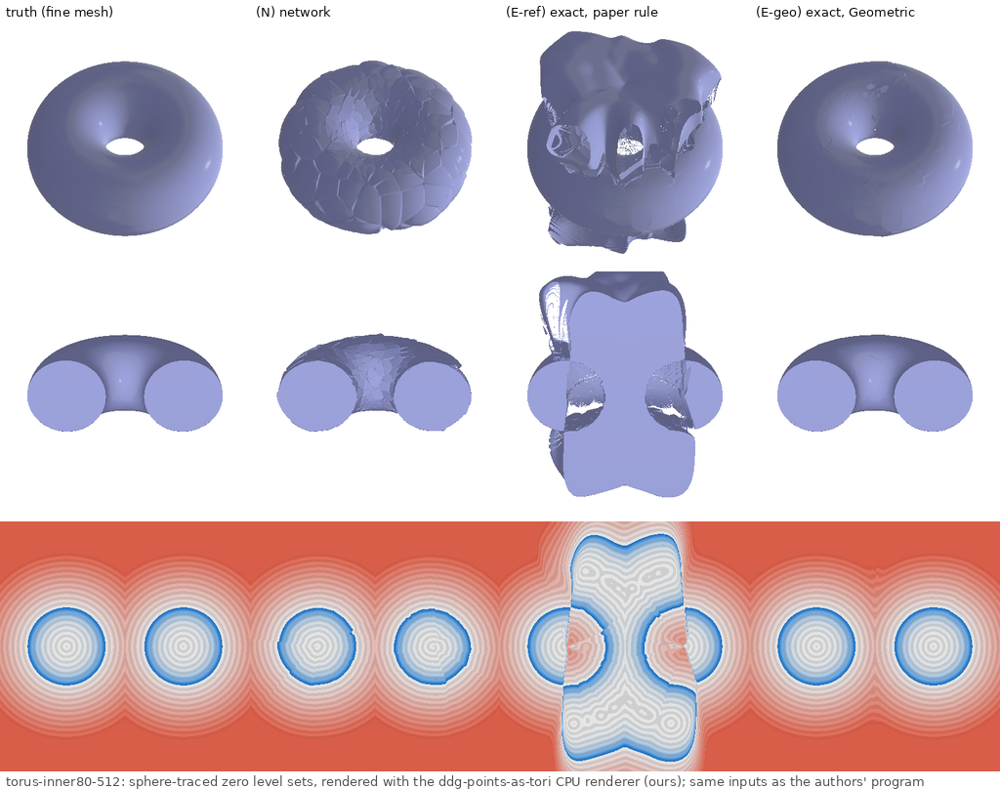
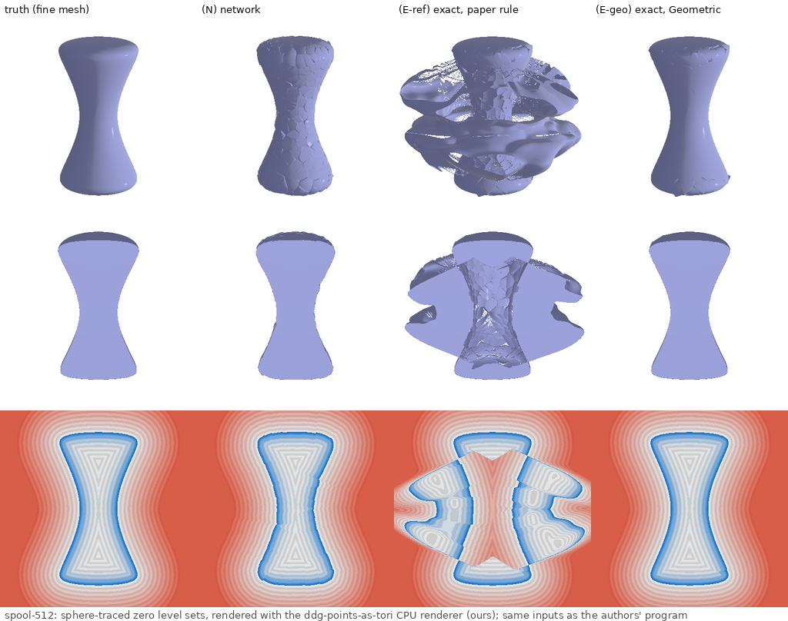
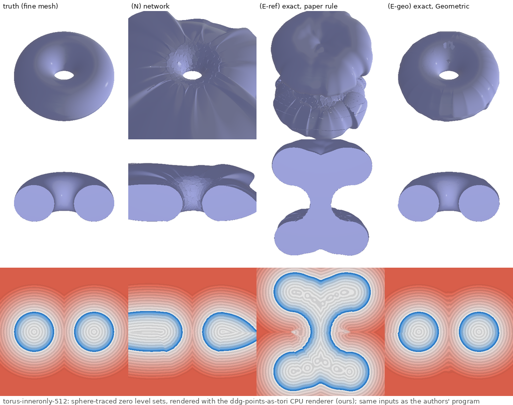
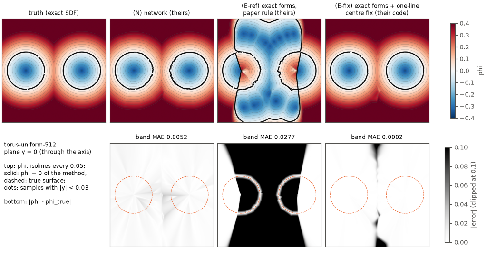
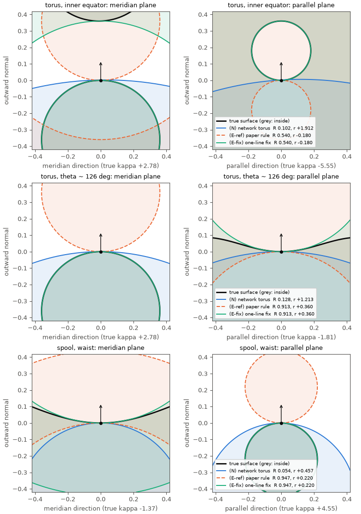

# Saddle demonstration: what the torus model does at saddles, with the authors' network and with exact forms

**Question (user).** The released network almost never predicts saddle or anisotropic tori
(EVALUATION.md, "Sign rule" and "Why the rule rarely matters"), and the paper's torus formula puts the
torus on the wrong side at saddles (Lean `pat-fit-contact`, NOTES-WP1.md). Can we manufacture a surface
that shows the failure, "literally tracing the inside of a torus"?

**Answer in one paragraph.** Yes, but the failure that shows up is not the one you might expect. On
surfaces where 30–100 % of the points are saddles, the authors' network still predicts **0 saddle tori
out of 512–2048** and its tori are 100 % spindle tori with median R/|r| ≈ 0.09 (near-spheres, each
convex towards the outside). The blend of these near-spheres is nevertheless **accurate at saddles**:
narrow-band error 0.0004–0.006, no worse than at the convex points of the same shape (it follows
the sampling density, not the sign of K). Its zero level set is visibly faceted ("scales"), and
its band error at saddles is 13–81× that of what the torus model can do with correct forms. The paper's sign rule is the real
failure, and it is dramatic, but only when the tori are correct: given the **exact** fundamental forms,
the authors' own fit (`fit_tori_from_forms`) builds every saddle torus inside out (100 % of the saddle
tori have ∇g·n = −1 at their contact point). The field near saddles is then ≈ −φ_true (band error
≈ 0.05 = 2 × mean |φ| in the band, 88–100 % of the near-surface points on the wrong side), and
spurious sheets plug the torus hole and wrap the spool (Hausdorff 0.71–0.81 on a shape of size 2).
Moving the centre of each saddle torus to the osculating side (**one line of numpy** on the
authors' output, = our `SignRule::Geometric`) makes the same exact-form field essentially exact
(band error 8e-6–5e-4 at saddles, up to 9e-4 at the spool's cap rim; Hausdorff ≤ 0.013 at saddles). So the network hides the sign bug by never predicting
saddles. Our hypothesis, not tested here: the bug may be *why* it learned never to predict them,
since under the paper's rule a correct saddle prediction is an inside-out torus, which the
training loss penalizes.

**Where the numbers come from.** Inputs are generated once in numpy and read by both programs. All
headline numbers and the matplotlib figures (slices, individual tori, chart) are from **the authors'
program** (`points-as-tori`, MIT, Nicole Feng; their network, kNN, `fit_tori_from_forms` and SDF,
unmodified, on the CPU). The (E-fix) column is "their code + one-line sign fix". **Our crate**
reproduces (N) to 7.6e-7, (E-ref) to 2e-12, and (E-fix) with `SignRule::Geometric` to 2e-12 (cross-check
table below). The 3D renders are made with **our** renderer (`src/render`) on our crate's fields,
because the authors' viewer is interactive (polyscope) and not headless. They are labelled as ours.

## The shapes and the inputs

| shape | definition | saddle area fraction | cases |
|---|---|---|---|
| fat torus about z | R 0.54, r 0.36 (the requested R .30, r .20, ×1.8 to fill the [−1, 1]³ box; hole radius 0.18; inner-equator curvatures +2.78 / −5.56) | 28.8 % (= ½ − r/(πR)) | `torus-uniform` (area-uniform), `torus-inner80` (80 % of the points on the inner half, cos θ < 0, all saddle), `torus-inneronly` (points **only** on the inner half: an open patch, "the inside of a torus") |
| spool (hourglass) about z | z = h sin u, ρ = √(a² + b²z²) · cos u · √(Σ_{j<8} sin^{2j} u), h 0.9, a 0.22, b 0.55: a one-sheet hyperboloid waist (K < 0) closed by smooth (analytic) round caps | 47.2 % | `spool` (area-uniform) |

Each at 512 and 2048 points (the network's regime), exact unit outward normals, no noise.
WP8's moon ring (69 % saddle) was not added: its crescent profile has corners, so the "exact forms" are
undefined there. The spool's caps are reported separately as the convex region.

**Exact coefficients.** The fit's Monge patch is Q(s, t) = a00 + a10 s + a01 t + a11 st + a20 s² +
a02 t² along n in the frame (ŝ, t̂) = `local_frame(n)` (the authors' `orthonormal_basis`, rotation 0),
columns (a00, a01, a10, a11, a02, a20), in physical units (the network's σ scaling, (σy0, y1, y2,
y3/σ, y4/σ, y5/σ), has already been applied when the fit sees them). With the exact normal, a00 = a01 =
a10 = 0 and the height is −½ xᵀSx (S the shape operator, convex positive), so
a20 = −S(ŝ,ŝ)/2, a02 = −S(t̂,t̂)/2, a11 = −S(ŝ,t̂). S comes from the analytic principal curvatures
and directions (meridian and parallel of the surface of revolution), and the coefficients are stored as
f32. Both programs read the same values.

**Verification of the mapping** (`verify/`, both programs):

| points | expected | authors' fit | our fit (`fit_tori_with`, both rules) |
|---|---|---|---|
| sphere r 0.5, 8 normals (both frame branches) | centre 0, R 0, r 0.5 | exact (0 error) | exact; `fit_diagnostics` κ exact |
| torus outer equator, 6 points, torus rotated by a generic rotation | the torus itself: centre 0, axis, R .54, r .36 | errors ≤ 4e-8 | same; κ error ≤ 5e-8 (f32 coefficients) |
| torus inner equator (saddle), 6 points, rotated | osculating torus R .54, r .18 tube about the parallel circle, centre R e_ρ; paper rule: mirror centre (R − 2r) e_ρ | paper-rule centre as predicted (1e-8); fixed centre = osculating (1e-8) | Reference: ∇g·n = −1 at the contact point; Geometric: +1, centre R e_ρ |
| torus outer equator, axis **not** rotated (principal directions on the frame axes, a11 = 0) | the torus itself | **R = 0, r = 0.36**: a sphere | the same with `EigenRule::Reference`; exact with `EigenRule::Robust` |

The last row is a side finding: with *exact* inputs whose principal directions coincide with the
local frame (v2 = 0), the reference eigenvector pair degenerates (NOTES-WP2.md item 1) and both
programs fit a sphere of radius 1/κmax. This is why the verification torus is rotated. On the
demo's samples it does not occur: our `fit_diagnostics` on the exact coefficients reproduces the
true κ to ≤ 5.8e-8 relative on every point of every case.

## Methods

| label | what | code |
|---|---|---|
| (N) | the released network + fit + SDF: `PointsAsTori(P, N)`, 32-NN evaluation, λ = 64/σ_x (their default) | theirs; ours = `Model::reference()`, `SignRule::Reference` (passed explicitly) |
| (N) all | the same tori, all points in the blend (`accelerate=False`) | theirs / ours `Neighborhood::All` |
| (E-ref) | exact forms → `fit_tori_from_forms` (the paper's rule) → their SDF | theirs; ours `fit_tori_with(SignRule::Reference)` + `TorusField::new` |
| (E-fix) | (E-ref)'s tori with `c ← 2(p + a00 n) − c` where `4 a20 a02 − a11² < 0` (det II < 0), radii, axis and sign unchanged | their code + one-line fix (`theirs.py: fix_saddle_centres`) |
| (E-geo) | exact forms, `SignRule::Geometric` | ours (equal to (E-fix) to 2e-12) |
| GWN | sign from the winding number of the oriented points (their CGAL point areas), magnitude = distance to the nearest sample | theirs (their `winding_number` returns minus the usual GWN: −1 inside; we threshold at −½) |

The one-line fix also applies to (N), but the network predicts no saddle on any case, so N-fix = N.
No API was added to the crate: `fit_tori_with` + `TorusField::new` already build a field from given
coefficients. The example `examples/saddle_demo.rs` does it.

## Results

Metrics are computed by one neutral numpy script (`tools/saddle_demo/metrics.py`) from each
method's grids. Grid: 64³ on [−1, 1]³ (as WP14's `eval`). Band: |φ_true| < 0.05. Region of a grid point
= sign of K at its nearest true surface point. "Near-surface sign error" = wrong sign at 0.005 <
|φ_true| < 0.05. Zero level set: marching cubes (scikit-image) on a 128³ grid, exact distances to the
true surface both ways (vertex → analytic SDF, dense truth samples → point-to-triangle). For the open
patch everything is restricted to where the nearest surface point has cos θ < −0.2, |φ_true| < 0.1,
and (level set) within 0.1 of a sample.

### Headline (authors' program; E-fix = their code + one-line fix)

| case | method | band MAE saddle | band MAE convex | near-surface sign err, saddle | Hausdorff of φ=0, saddle | grid MAE |
|---|---|---|---|---|---|---|
| torus-uniform-512 | N | 0.0063 | 0.0033 | 3.0 % | 0.066 | 0.0035 |
| torus-uniform-512 | E-ref | 0.0469 | 0.0013 | 88.2 % | 0.712 | 0.0989 |
| torus-uniform-512 | E-fix | 0.0005 | 0.0001 | 0.0 % | 0.013 | 0.0004 |
| torus-uniform-512 | GWN | 0.0463 | 0.0445 | 0.6 % | 0.022 | 0.0155 |
| torus-uniform-2048 | N | 0.0014 | 0.0007 | 0.0 % | 0.015 | 0.0008 |
| torus-uniform-2048 | E-ref | 0.0484 | 0.0007 | 96.6 % | 0.714 | 0.0995 |
| torus-uniform-2048 | E-fix | 0.0001 | 0.0000 | 0.0 % | 0.001 | 0.0001 |
| torus-uniform-2048 | GWN | 0.0175 | 0.0175 | 0.0 % | 0.013 | 0.0046 |
| torus-inner80-512 | N | 0.0032 | 0.0129 | 0.3 % | 0.031 | 0.0092 |
| torus-inner80-512 | E-ref | 0.0494 | 0.0048 | 98.2 % | 0.714 | 0.1405 |
| torus-inner80-512 | E-fix | 0.0001 | 0.0004 | 0.0 % | 0.004 | 0.0005 |
| torus-inner80-512 | GWN | 0.0244 | 0.0965 | 4.2 % | 0.061 | 0.0303 |
| torus-inner80-2048 | N | 0.0006 | 0.0025 | 0.0 % | 0.005 | 0.0019 |
| torus-inner80-2048 | E-ref | 0.0497 | 0.0021 | 99.5 % | 0.717 | 0.1233 |
| torus-inner80-2048 | E-fix | 0.0000 | 0.0001 | 0.0 % | 0.000 | 0.0001 |
| torus-inner80-2048 | GWN | 0.0084 | 0.0400 | 0.0 % | 0.013 | 0.0104 |
| torus-inneronly-512 (open) | N | 0.0018 | — | 0.1 % | 0.017 | 0.0018 |
| torus-inneronly-512 (open) | E-ref | 0.0501 | — | 99.7 % | 0.023 | 0.0978 |
| torus-inneronly-512 (open) | E-fix | 0.0001 | — | 0.0 % | 0.002 | 0.0001 |
| torus-inneronly-512 (open) | GWN | 0.0392 | — | 38.9 % | 0.086 | 0.0598 |
| torus-inneronly-2048 (open) | N | 0.0004 | — | 0.0 % | 0.005 | 0.0004 |
| torus-inneronly-2048 (open) | E-ref | 0.0502 | — | 100.0 % | 0.010 | 0.0983 |
| torus-inneronly-2048 (open) | E-fix | 0.0000 | — | 0.0 % | 0.000 | 0.0000 |
| torus-inneronly-2048 (open) | GWN | 0.0292 | — | 40.9 % | 0.047 | 0.0518 |
| spool-512 | N | 0.0029 | 0.0073 | 0.4 % | 0.021 | 0.0063 |
| spool-512 | E-ref | 0.0480 | 0.0031 | 94.8 % | 0.813 | 0.2263 |
| spool-512 | E-fix | 0.0001 | 0.0009 | 0.0 % | 0.003 | 0.0012 |
| spool-512 | GWN | 0.0331 | 0.0330 | 0.5 % | 0.021 | 0.0097 |
| spool-2048 | N | 0.0007 | 0.0014 | 0.0 % | 0.008 | 0.0015 |
| spool-2048 | E-ref | 0.0487 | 0.0013 | 98.7 % | 0.764 | 0.2220 |
| spool-2048 | E-fix | 0.0000 | 0.0001 | 0.0 % | 0.000 | 0.0004 |
| spool-2048 | GWN | 0.0122 | 0.0125 | 0.0 % | 0.010 | 0.0027 |



### What the network predicts at saddles (authors' coefficients, convex positive, × σ)

| case | true saddle frac | predicted | true (κmin σ, κmax σ) at saddles | predicted | true / predicted anisotropy at saddles |
|---|---|---|---|---|---|
| torus-uniform-512 | 27.3 % | 0 % | (−0.12, 0.96) | (0.30, 0.32) | 0.49 / 0.92 |
| torus-inner80-2048 | 80.0 % | 0 % | (−0.05, 0.31) | (0.07, 0.08) | 0.50 / 0.92 |
| torus-inneronly-512 | 100 % | 0 % | (−0.07, 0.59) | (0.10, 0.11) | 0.50 / 0.93 |
| spool-512 | 47.3 % | 0 % | (−0.13, 0.95) | (0.49, 0.55) | 0.14 / 0.89 |
| spool-2048 | 47.2 % | 0 % | (−0.07, 0.48) | (0.19, 0.21) | 0.15 / 0.90 |

At a saddle the network predicts a near-sphere whose curvature is close to the **mean** curvature
(the median predicted H σ is within 0.12 of the true median on every case, within 0.02 on five of the eight): the best isotropic fit,
not a saddle. All its tori are spindle tori (R < |r|, median R/|r| 0.08–0.10), none is inside out
at its contact point. With the exact forms, (E-ref) is inside out at **100 %** of the saddle points
and (E-fix) at 0 %. Full table in the appendix.

### Cross-check: our crate vs the authors' program (same inputs, max |Δφ| on the 64³ grid)

| case | N | N all | E-ref | E-ref all | E-fix (theirs) vs E-geo (ours) | 128³: N / E-ref / E-fix | network coefficients |
|---|---|---|---|---|---|---|---|
| all 8 cases, worst | 7.6e-7 | 4.7e-7 | 1.9e-12 | 1.9e-12 | 1.9e-12 (all points 1.7e-12) | 7.6e-7 / 3.0e-8 / 1.5e-8 (f32 storage) | 4.3e-6 |

The (N) difference comes from the f32 network (COMPARISON.md: ~1e-6). The GWN baselines differ
(max 0.1–0.7 at isolated grid points near the samples) because the point areas are computed
differently (their CGAL `point_areas`, k 20; ours Barill's, k 20 with the opposite-normal filter).
Only theirs is in the headline. Per-case values are in the appendix.

## Pictures

All in `showcase/points-as-tori/saddle-demo/` (README there).

**Renders (ours: the crate's CPU sphere tracer, 384² per panel).** Columns: truth (fine mesh), (N),
(E-ref), (E-geo). Rows: the surface, a cutaway with the camera-side half removed (the tube
cross-sections), the renderer's cut plane y = 0 through the axis, coloured by the method's φ with
isobands every 0.05 (blue inside, red outside).



- (N): the surface is right but scaly. Every scale is one near-sphere torus. The cut plane is
  close to the truth.
- (E-ref): an hourglass-shaped solid plugs the hole (the inside-out saddle tori of the inner wall
  claim the hole as "inside"), plus sheets above and below. In the cut plane, the inner walls of the
  tubes are red: inside and outside swapped.
- (E-geo): indistinguishable from the truth.





The open patch ("the inside of a torus"): near the samples (N) is right. Away from them it closes
the tube with a large sheet (the far field is undetermined there, so this is expected). (E-ref) turns
the whole patch inside out: the tube cross-sections become outside and the hole becomes a solid
neck. (E-geo) reconstructs the whole torus from the inner half alone, because the osculating tori of
the inner wall extrapolate correctly.

**Slices (theirs, matplotlib from their arrays)**, plane y = 0, φ and |φ − φ_true|:



**Individual tori at saddle points (theirs)**: the true surface, the network's torus, the paper-rule
torus and the fixed torus, cut by the two principal planes at the contact point (shaded: each torus's
inside):



At the inner equator the network's torus (R 0.10, r 1.91) is a large sphere on the outer side
of the inner wall: right in neither plane, but it blends acceptably. The paper-rule torus has the right
radii (R .54, r .18). Its centre is mirrored, so its tube lies on the solid side and its inside
(shaded) is the hole. The fixed torus osculates in both planes.

## Conclusions

1. **The network does not fail at saddles in the way the question expected.** Its tori are
   near-spheres everywhere (0 saddles predicted on 8 saddle-dominated clouds), yet the blended field
   is as accurate at saddle points as at convex ones. Its error tracks the sampling density (the
   20 %-sampled convex half of `torus-inner80` is its worst region), not the sign of K. Where it
   loses is precision: its zero set is faceted, and its band error at saddles is 13–81× that of
   the correct exact-form tori (E-fix).
2. **The paper's sign rule fails exactly where the torus model is most useful.** With correct
   curvature input it inverts every saddle torus. The field near saddle surface is then ≈ −φ_true,
   with spurious solids in the torus hole and around the spool waist. The authors' released
   program does this today if it is fed good forms (`fit_tori_from_forms` with exact coefficients).
3. **The fix is one line and is exact.** Reflecting the saddle centres through the contact point
   (det II < 0) on the authors' output gives our `SignRule::Geometric` to 2e-12 and an essentially
   exact field (band MAE ≤ 5e-4 at 512 points, ≤ 7e-5 at 2048).
4. **The two findings are connected (hypothesis).** Under the paper's rule a network that predicted a
   saddle would be punished for being right, so near-spheres are the safe output. That is consistent
   with what we see. It is the question the Geometric retraining (WP10) answers.

## Caveats

- (E-ref)/(E-fix)/(E-geo) are **oracles**: exact normals and exact second fundamental forms. No
  practical method has them. They show the ceiling of the torus representation and isolate the sign
  rule; they do not say what a better network would reach.
- Clean, area-uniform (or two-density) samples, no noise. The network was trained on noisy blobs; its
  near-sphere output may be a reasonable hedge under noise.
- The grids are coarse (64³ for errors, 128³ for level sets, h = 0.016). Level-set distances
  below ~1e-3 are at the discretization limit, and "0.0000" means < 5e-5.
- GWN is a simple baseline (unregularized point winding number for the sign, nearest-sample distance
  for the magnitude); its band error is dominated by the sample spacing by construction.
- Saddle region = K < 0 at the nearest surface point. Grid points near the parabolic lines are
  assigned by that rule.
- Open patch: the far field of an open patch is not defined, so only the restricted metrics are
  meaningful. The "sign errors" of GWN there reflect that GWN's 0.5 level is not the patch.
- The renders use our renderer on our fields. The cross-check makes them equal to the authors' fields
  to < 1e-6, but the pictures themselves are not from their code.

## Reproduce

```
# 1. inputs (numpy), into runs_tmp/pat-saddle
uv run --with numpy --with scipy python -I crates/ddg-points-as-tori/tools/saddle_demo/make_inputs.py runs_tmp/pat-saddle
# 2. the authors' program (their venv, CPU only, 8 threads, nice 19; see run_theirs.sh)
crates/ddg-points-as-tori/tools/saddle_demo/run_theirs.sh            # all cases + verify
# 3. our crate
CARGO_TARGET_DIR=target-pat-saddle cargo build --release -p ddg-points-as-tori --example saddle_demo
target-pat-saddle/release/examples/saddle_demo verify runs_tmp/pat-saddle
crates/ddg-points-as-tori/tools/saddle_demo/run_ours.sh
target-pat-saddle/release/examples/saddle_demo render runs_tmp/pat-saddle <case> runs_tmp/pat-saddle/renders --res 384
# 4. metrics, tables, figures (neutral numpy / matplotlib)
uv run --with numpy --with scipy --with scikit-image python -I .../metrics.py runs_tmp/pat-saddle
python3 -I .../tables.py runs_tmp/pat-saddle > runs_tmp/pat-saddle/tables.md
uv run --with numpy --with scipy --with matplotlib python -I .../plots.py runs_tmp/pat-saddle runs_tmp/pat-saddle/figs
uv run --with pillow python -I .../montage.py runs_tmp/pat-saddle/renders <case> <out.png>
```

The scripts hard-code the run directory `runs_tmp/pat-saddle` and the authors' build in
`/var/data/discrete-geometry/PointsAsTori-build/` (see runs_tmp/pat-ref/README.md for its recipe). The
driver scripts were run from `runs_tmp/pat-saddle/driver/`; `tools/saddle_demo/` holds identical
copies. Wall time: about 25 min on 8 threads.

# Appendix: all tables (generated by `tables.py`)

## Field error by region (64³ grid; band |φ_true| < 0.05; region = sign of K at the nearest true surface point)

### spool-2048 (area-uniform; 47.2 % of the points are saddles)

| method | grid MAE | band MAE saddle | band MAE convex | band max saddle | near sign err saddle | near sign err convex | far sign err | eik band |
|---|---|---|---|---|---|---|---|---|
| (N) network, theirs | 0.0015 | 0.0007 | 0.0014 | 0.007 | 0.0 % | 0.3 % | 0.0 % | 0.010 |
| (N) all points, theirs | 0.0017 | 0.0006 | 0.0014 | 0.005 | 0.0 % | 0.2 % | 0.0 % | 0.006 |
| (E-ref) exact, paper rule, theirs | 0.2220 | 0.0487 | 0.0013 | 0.104 | 98.7 % | 2.1 % | 29.1 % | 0.037 |
| (E-fix) exact + one-line fix, their code | 0.0004 | 0.0000 | 0.0001 | 0.000 | 0.0 % | 0.0 % | 0.0 % | 0.004 |
| (E-geo) exact, Geometric, ours | 0.0004 | 0.0000 | 0.0001 | 0.000 | 0.0 % | 0.0 % | 0.0 % | 0.004 |
| GWN sign + distance, theirs | 0.0027 | 0.0122 | 0.0125 | 0.072 | 0.0 % | 0.1 % | 0.0 % | 0.340 |

| zero level set (MC 128³) | mean sym. dist. saddle | convex | Hausdorff saddle | convex | recon→truth max (all) |
|---|---|---|---|---|---|
| (N) network, theirs | 0.0007 | 0.0015 | 0.008 | 0.013 | 0.013 |
| (E-ref) exact, paper rule, theirs | 0.2065 | 0.0812 | 0.764 | 0.689 | 0.764 |
| (E-fix) exact + one-line fix, their code | 0.0000 | 0.0002 | 0.000 | 0.008 | 0.008 |
| (E-geo) exact, Geometric, ours | 0.0000 | 0.0002 | 0.000 | 0.008 | 0.008 |
| GWN sign + distance, theirs | 0.0022 | 0.0025 | 0.010 | 0.016 | 0.016 |

### spool-512 (area-uniform; 47.3 % of the points are saddles)

| method | grid MAE | band MAE saddle | band MAE convex | band max saddle | near sign err saddle | near sign err convex | far sign err | eik band |
|---|---|---|---|---|---|---|---|---|
| (N) network, theirs | 0.0063 | 0.0029 | 0.0073 | 0.027 | 0.4 % | 3.7 % | 0.0 % | 0.018 |
| (N) all points, theirs | 0.0066 | 0.0026 | 0.0073 | 0.016 | 0.2 % | 3.8 % | 0.0 % | 0.010 |
| (E-ref) exact, paper rule, theirs | 0.2263 | 0.0480 | 0.0031 | 0.142 | 94.8 % | 4.3 % | 29.8 % | 0.050 |
| (E-fix) exact + one-line fix, their code | 0.0012 | 0.0001 | 0.0009 | 0.003 | 0.0 % | 0.3 % | 0.0 % | 0.008 |
| (E-geo) exact, Geometric, ours | 0.0012 | 0.0001 | 0.0009 | 0.003 | 0.0 % | 0.3 % | 0.0 % | 0.008 |
| GWN sign + distance, theirs | 0.0097 | 0.0331 | 0.0330 | 0.151 | 0.5 % | 1.7 % | 0.0 % | 0.790 |

| zero level set (MC 128³) | mean sym. dist. saddle | convex | Hausdorff saddle | convex | recon→truth max (all) |
|---|---|---|---|---|---|
| (N) network, theirs | 0.0028 | 0.0072 | 0.021 | 0.041 | 0.041 |
| (E-ref) exact, paper rule, theirs | 0.2015 | 0.1078 | 0.813 | 0.809 | 0.813 |
| (E-fix) exact + one-line fix, their code | 0.0001 | 0.0009 | 0.003 | 0.029 | 0.029 |
| (E-geo) exact, Geometric, ours | 0.0001 | 0.0009 | 0.003 | 0.029 | 0.029 |
| GWN sign + distance, theirs | 0.0038 | 0.0052 | 0.021 | 0.045 | 0.045 |

### torus-inner80-2048 (80% inner half, 20% outer half, area-uniform within each; 80.0 % of the points are saddles)

| method | grid MAE | band MAE saddle | band MAE convex | band max saddle | near sign err saddle | near sign err convex | far sign err | eik band |
|---|---|---|---|---|---|---|---|---|
| (N) network, theirs | 0.0019 | 0.0006 | 0.0025 | 0.004 | 0.0 % | 0.3 % | 0.0 % | 0.010 |
| (N) all points, theirs | 0.0022 | 0.0005 | 0.0024 | 0.003 | 0.0 % | 0.2 % | 0.0 % | 0.005 |
| (E-ref) exact, paper rule, theirs | 0.1233 | 0.0497 | 0.0021 | 0.102 | 99.5 % | 4.2 % | 25.0 % | 0.027 |
| (E-fix) exact + one-line fix, their code | 0.0001 | 0.0000 | 0.0001 | 0.000 | 0.0 % | 0.0 % | 0.0 % | 0.001 |
| (E-geo) exact, Geometric, ours | 0.0001 | 0.0000 | 0.0001 | 0.000 | 0.0 % | 0.0 % | 0.0 % | 0.001 |
| GWN sign + distance, theirs | 0.0104 | 0.0084 | 0.0400 | 0.060 | 0.0 % | 2.2 % | 0.0 % | 0.733 |

| zero level set (MC 128³) | mean sym. dist. saddle | convex | Hausdorff saddle | convex | recon→truth max (all) |
|---|---|---|---|---|---|
| (N) network, theirs | 0.0006 | 0.0025 | 0.005 | 0.023 | 0.023 |
| (E-ref) exact, paper rule, theirs | 0.0679 | 0.0798 | 0.717 | 0.652 | 0.717 |
| (E-fix) exact + one-line fix, their code | 0.0000 | 0.0001 | 0.000 | 0.002 | 0.002 |
| (E-geo) exact, Geometric, ours | 0.0000 | 0.0001 | 0.000 | 0.002 | 0.002 |
| GWN sign + distance, theirs | 0.0027 | 0.0058 | 0.013 | 0.040 | 0.040 |

### torus-inner80-512 (80% inner half, 20% outer half, area-uniform within each; 80.1 % of the points are saddles)

| method | grid MAE | band MAE saddle | band MAE convex | band max saddle | near sign err saddle | near sign err convex | far sign err | eik band |
|---|---|---|---|---|---|---|---|---|
| (N) network, theirs | 0.0092 | 0.0032 | 0.0129 | 0.028 | 0.3 % | 8.4 % | 0.0 % | 0.024 |
| (N) all points, theirs | 0.0089 | 0.0029 | 0.0127 | 0.024 | 0.2 % | 8.1 % | 0.0 % | 0.014 |
| (E-ref) exact, paper rule, theirs | 0.1405 | 0.0494 | 0.0048 | 0.112 | 98.2 % | 7.3 % | 28.6 % | 0.039 |
| (E-fix) exact + one-line fix, their code | 0.0005 | 0.0001 | 0.0004 | 0.004 | 0.0 % | 0.0 % | 0.0 % | 0.002 |
| (E-geo) exact, Geometric, ours | 0.0005 | 0.0001 | 0.0004 | 0.004 | 0.0 % | 0.0 % | 0.0 % | 0.002 |
| GWN sign + distance, theirs | 0.0303 | 0.0244 | 0.0965 | 0.181 | 4.2 % | 20.6 % | 0.5 % | 1.008 |

| zero level set (MC 128³) | mean sym. dist. saddle | convex | Hausdorff saddle | convex | recon→truth max (all) |
|---|---|---|---|---|---|
| (N) network, theirs | 0.0030 | 0.0126 | 0.031 | 0.096 | 0.096 |
| (E-ref) exact, paper rule, theirs | 0.0665 | 0.0890 | 0.714 | 0.665 | 0.714 |
| (E-fix) exact + one-line fix, their code | 0.0001 | 0.0003 | 0.004 | 0.008 | 0.008 |
| (E-geo) exact, Geometric, ours | 0.0001 | 0.0003 | 0.004 | 0.008 | 0.008 |
| GWN sign + distance, theirs | 0.0085 | 0.0294 | 0.061 | 0.163 | 0.163 |

### torus-inneronly-2048 (inner half only (cos theta < 0), open patch; evaluated where cos theta* < -0.2; 100.0 % of the points are saddles)

| method | grid MAE | band MAE saddle | band MAE convex | band max saddle | near sign err saddle | near sign err convex | far sign err | eik band |
|---|---|---|---|---|---|---|---|---|
| (N) network, theirs | 0.0004 | 0.0004 | — | 0.004 | 0.0 % | — | 0.0 % | 0.007 |
| (N) all points, theirs | 0.0004 | 0.0003 | — | 0.003 | 0.0 % | — | 0.0 % | 0.005 |
| (E-ref) exact, paper rule, theirs | 0.0983 | 0.0502 | — | 0.101 | 100.0 % | — | 100.0 % | 0.013 |
| (E-fix) exact + one-line fix, their code | 0.0000 | 0.0000 | — | 0.000 | 0.0 % | — | 0.0 % | 0.002 |
| (E-geo) exact, Geometric, ours | 0.0000 | 0.0000 | — | 0.000 | 0.0 % | — | 0.0 % | 0.002 |
| GWN sign + distance, theirs | 0.0518 | 0.0292 | — | 0.114 | 40.9 % | — | 48.9 % | 0.285 |

| zero level set (MC 128³) | mean sym. dist. saddle | convex | Hausdorff saddle | convex | recon→truth max (all) |
|---|---|---|---|---|---|
| (N) network, theirs | 0.0004 | 0.0000 | 0.005 | 0.000 | 0.005 |
| (E-ref) exact, paper rule, theirs | 0.0005 | 0.0000 | 0.010 | 0.000 | 0.010 |
| (E-fix) exact + one-line fix, their code | 0.0000 | 0.0000 | 0.000 | 0.000 | 0.000 |
| (E-geo) exact, Geometric, ours | 0.0000 | 0.0000 | 0.000 | 0.000 | 0.000 |
| GWN sign + distance, theirs | 0.0134 | 0.0000 | 0.047 | 0.000 | 0.047 |

### torus-inneronly-512 (inner half only (cos theta < 0), open patch; evaluated where cos theta* < -0.2; 100.0 % of the points are saddles)

| method | grid MAE | band MAE saddle | band MAE convex | band max saddle | near sign err saddle | near sign err convex | far sign err | eik band |
|---|---|---|---|---|---|---|---|---|
| (N) network, theirs | 0.0018 | 0.0018 | — | 0.016 | 0.1 % | — | 0.0 % | 0.016 |
| (N) all points, theirs | 0.0016 | 0.0016 | — | 0.012 | 0.0 % | — | 0.0 % | 0.010 |
| (E-ref) exact, paper rule, theirs | 0.0978 | 0.0501 | — | 0.109 | 99.7 % | — | 100.0 % | 0.030 |
| (E-fix) exact + one-line fix, their code | 0.0001 | 0.0001 | — | 0.002 | 0.0 % | — | 0.0 % | 0.003 |
| (E-geo) exact, Geometric, ours | 0.0001 | 0.0001 | — | 0.002 | 0.0 % | — | 0.0 % | 0.003 |
| GWN sign + distance, theirs | 0.0598 | 0.0392 | — | 0.154 | 38.9 % | — | 48.7 % | 0.369 |

| zero level set (MC 128³) | mean sym. dist. saddle | convex | Hausdorff saddle | convex | recon→truth max (all) |
|---|---|---|---|---|---|
| (N) network, theirs | 0.0017 | 0.0000 | 0.017 | 0.000 | 0.017 |
| (E-ref) exact, paper rule, theirs | 0.0021 | 0.0000 | 0.023 | 0.000 | 0.023 |
| (E-fix) exact + one-line fix, their code | 0.0001 | 0.0000 | 0.002 | 0.000 | 0.002 |
| (E-geo) exact, Geometric, ours | 0.0001 | 0.0000 | 0.002 | 0.000 | 0.002 |
| GWN sign + distance, theirs | 0.0214 | 0.0000 | 0.086 | 0.000 | 0.071 |

### torus-uniform-2048 (area-uniform; 29.8 % of the points are saddles)

| method | grid MAE | band MAE saddle | band MAE convex | band max saddle | near sign err saddle | near sign err convex | far sign err | eik band |
|---|---|---|---|---|---|---|---|---|
| (N) network, theirs | 0.0008 | 0.0014 | 0.0007 | 0.017 | 0.0 % | 0.0 % | 0.0 % | 0.007 |
| (N) all points, theirs | 0.0009 | 0.0012 | 0.0007 | 0.012 | 0.0 % | 0.0 % | 0.0 % | 0.004 |
| (E-ref) exact, paper rule, theirs | 0.0995 | 0.0484 | 0.0007 | 0.109 | 96.6 % | 1.6 % | 20.6 % | 0.027 |
| (E-fix) exact + one-line fix, their code | 0.0001 | 0.0001 | 0.0000 | 0.001 | 0.0 % | 0.0 % | 0.0 % | 0.001 |
| (E-geo) exact, Geometric, ours | 0.0001 | 0.0001 | 0.0000 | 0.001 | 0.0 % | 0.0 % | 0.0 % | 0.001 |
| GWN sign + distance, theirs | 0.0046 | 0.0175 | 0.0175 | 0.094 | 0.0 % | 0.0 % | 0.0 % | 0.462 |

| zero level set (MC 128³) | mean sym. dist. saddle | convex | Hausdorff saddle | convex | recon→truth max (all) |
|---|---|---|---|---|---|
| (N) network, theirs | 0.0014 | 0.0007 | 0.015 | 0.006 | 0.015 |
| (E-ref) exact, paper rule, theirs | 0.1157 | 0.0448 | 0.714 | 0.642 | 0.714 |
| (E-fix) exact + one-line fix, their code | 0.0001 | 0.0001 | 0.001 | 0.001 | 0.001 |
| (E-geo) exact, Geometric, ours | 0.0001 | 0.0001 | 0.001 | 0.001 | 0.001 |
| GWN sign + distance, theirs | 0.0025 | 0.0025 | 0.013 | 0.018 | 0.018 |

### torus-uniform-512 (area-uniform; 27.3 % of the points are saddles)

| method | grid MAE | band MAE saddle | band MAE convex | band max saddle | near sign err saddle | near sign err convex | far sign err | eik band |
|---|---|---|---|---|---|---|---|---|
| (N) network, theirs | 0.0035 | 0.0063 | 0.0033 | 0.063 | 3.0 % | 0.6 % | 0.0 % | 0.018 |
| (N) all points, theirs | 0.0038 | 0.0059 | 0.0033 | 0.059 | 2.5 % | 0.6 % | 0.0 % | 0.011 |
| (E-ref) exact, paper rule, theirs | 0.0989 | 0.0469 | 0.0013 | 0.146 | 88.2 % | 2.2 % | 20.7 % | 0.038 |
| (E-fix) exact + one-line fix, their code | 0.0004 | 0.0005 | 0.0001 | 0.017 | 0.0 % | 0.0 % | 0.0 % | 0.002 |
| (E-geo) exact, Geometric, ours | 0.0004 | 0.0005 | 0.0001 | 0.017 | 0.0 % | 0.0 % | 0.0 % | 0.002 |
| GWN sign + distance, theirs | 0.0155 | 0.0463 | 0.0445 | 0.196 | 0.6 % | 1.1 % | 0.0 % | 1.049 |

| zero level set (MC 128³) | mean sym. dist. saddle | convex | Hausdorff saddle | convex | recon→truth max (all) |
|---|---|---|---|---|---|
| (N) network, theirs | 0.0062 | 0.0032 | 0.066 | 0.034 | 0.066 |
| (E-ref) exact, paper rule, theirs | 0.1156 | 0.0553 | 0.712 | 0.649 | 0.712 |
| (E-fix) exact + one-line fix, their code | 0.0005 | 0.0001 | 0.013 | 0.007 | 0.013 |
| (E-geo) exact, Geometric, ours | 0.0005 | 0.0001 | 0.013 | 0.007 | 0.013 |
| GWN sign + distance, theirs | 0.0040 | 0.0045 | 0.022 | 0.035 | 0.035 |

## Curvatures at the input points (authors' network coefficients vs truth; convex positive, × σ)

| case | true saddle frac | predicted saddle frac | true (κmin σ, κmax σ) at saddles | predicted | true H σ | predicted H σ | anisotropy true / pred (saddles) |
|---|---|---|---|---|---|---|---|
| spool-2048 | 47.2 % | 0.0 % | (-0.07, 0.48) | (0.19, 0.21) | 0.20 | 0.20 | 0.15 / 0.90 |
| spool-512 | 47.3 % | 0.0 % | (-0.13, 0.95) | (0.49, 0.55) | 0.41 | 0.52 | 0.14 / 0.89 |
| torus-inner80-2048 | 80.0 % | 0.0 % | (-0.05, 0.31) | (0.07, 0.08) | 0.07 | 0.08 | 0.50 / 0.92 |
| torus-inner80-512 | 80.1 % | 0.0 % | (-0.11, 0.63) | (0.13, 0.14) | 0.13 | 0.13 | 0.51 / 0.93 |
| torus-inneronly-2048 | 100.0 % | 0.0 % | (-0.04, 0.28) | (0.07, 0.07) | 0.07 | 0.07 | 0.50 / 0.92 |
| torus-inneronly-512 | 100.0 % | 0.0 % | (-0.07, 0.59) | (0.10, 0.11) | 0.14 | 0.11 | 0.50 / 0.93 |
| torus-uniform-2048 | 29.8 % | 0.0 % | (-0.07, 0.49) | (0.13, 0.15) | 0.12 | 0.14 | 0.50 / 0.93 |
| torus-uniform-512 | 27.3 % | 0.0 % | (-0.12, 0.96) | (0.30, 0.32) | 0.26 | 0.31 | 0.49 / 0.92 |

## The tori (authors' program): inside-out at the contact point (∇g·n < 0), spindle fraction, median R/|r|

| case | N inside-out (saddle pts) | N spindle | N median R/r | E-ref inside-out (saddle pts) | E-fix inside-out (saddle pts) | E spindle (saddle pts) |
|---|---|---|---|---|---|---|
| spool-2048 | 0.0 % | 100.0 % | 0.09 | 100.0 % | 0.0 % | 0.0 % |
| spool-512 | 0.0 % | 100.0 % | 0.10 | 100.0 % | 0.0 % | 0.0 % |
| torus-inner80-2048 | 0.0 % | 100.0 % | 0.09 | 100.0 % | 0.0 % | 0.0 % |
| torus-inner80-512 | 0.0 % | 100.0 % | 0.08 | 100.0 % | 0.0 % | 0.0 % |
| torus-inneronly-2048 | 0.0 % | 100.0 % | 0.09 | 100.0 % | 0.0 % | 0.0 % |
| torus-inneronly-512 | 0.0 % | 100.0 % | 0.08 | 100.0 % | 0.0 % | 0.0 % |
| torus-uniform-2048 | 0.0 % | 100.0 % | 0.09 | 100.0 % | 0.0 % | 0.0 % |
| torus-uniform-512 | 0.0 % | 100.0 % | 0.08 | 100.0 % | 0.0 % | 0.0 % |

## Cross-check: our crate vs the authors' program on the same inputs (max |Δφ| over the grid)

| case | theirs:N vs ours:Nref | theirs:N-all vs ours:Nref-all | theirs:Eref vs ours:Eref | theirs:Eref-all vs ours:Eref-all | theirs:Efix vs ours:Egeo | theirs:Efix-all vs ours:Egeo-all | theirs:gwn vs ours:gwn | 128: theirs:N vs ours:Nref | 128: theirs:Eref vs ours:Eref | 128: theirs:Efix vs ours:Egeo | net_coeffs theirs vs ours |
|---|---|---|---|---|---|---|---|---|---|---|---|
| spool-2048 | 5.3e-08 | 3.3e-08 | 6.0e-13 | 1.5e-13 | 6.0e-13 | 1.5e-13 | 1.2e-01 | 1.2e-07 | 0.0e+00 | 0.0e+00 | 4.3e-06 |
| spool-512 | 6.7e-08 | 4.6e-08 | 9.3e-13 | 7.4e-13 | 9.2e-13 | 5.0e-13 | 2.8e-01 | 1.2e-07 | 9.3e-10 | 0.0e+00 | 2.6e-06 |
| torus-inner80-2048 | 6.3e-08 | 5.2e-08 | 2.0e-13 | 1.2e-13 | 3.5e-13 | 2.6e-13 | 3.2e-01 | 7.5e-08 | 0.0e+00 | 0.0e+00 | 3.2e-06 |
| torus-inner80-512 | 1.9e-07 | 1.0e-07 | 4.5e-13 | 4.5e-13 | 6.8e-13 | 6.7e-13 | 6.3e-01 | 2.1e-07 | 7.5e-09 | 9.3e-10 | 1.2e-06 |
| torus-inneronly-2048 | 7.6e-07 | 4.7e-07 | 1.7e-12 | 7.3e-13 | 1.7e-12 | 8.3e-13 | 3.1e-01 | 7.6e-07 | 3.7e-09 | 1.5e-08 | 4.1e-06 |
| torus-inneronly-512 | 4.7e-07 | 3.7e-07 | 1.9e-12 | 1.9e-12 | 1.9e-12 | 1.7e-12 | 7.0e-01 | 4.8e-07 | 3.0e-08 | 3.7e-09 | 1.3e-06 |
| torus-uniform-2048 | 6.1e-08 | 3.6e-08 | 1.7e-13 | 9.6e-14 | 1.1e-13 | 9.6e-14 | 1.8e-01 | 6.4e-08 | 0.0e+00 | 0.0e+00 | 3.5e-06 |
| torus-uniform-512 | 6.3e-08 | 4.9e-08 | 1.1e-13 | 7.3e-14 | 1.1e-13 | 7.3e-14 | 4.1e-01 | 6.3e-08 | 0.0e+00 | 0.0e+00 | 1.1e-06 |

exact-coefficient fit_diagnostics vs true κ (max relative error): spool-2048: 5.8e-08, spool-512: 5.2e-08, torus-inner80-2048: 5.6e-08, torus-inner80-512: 5.2e-08, torus-inneronly-2048: 5.3e-08, torus-inneronly-512: 5.8e-08, torus-uniform-2048: 5.2e-08, torus-uniform-512: 4.9e-08
