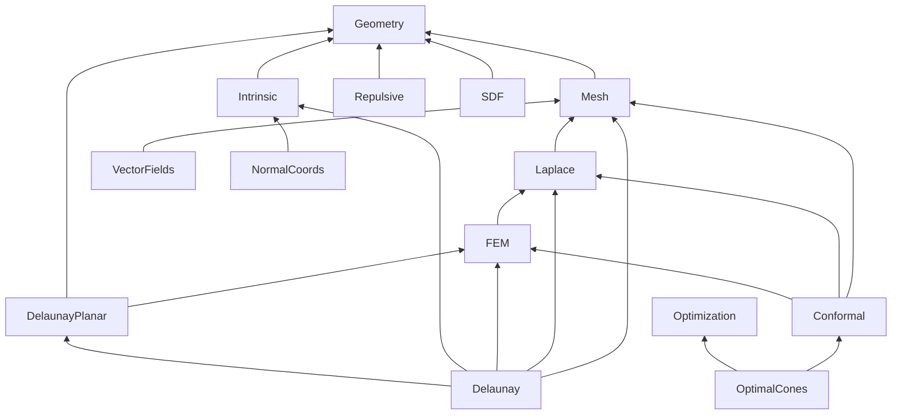

# DDG: a formally verified library of discrete differential geometry

`DDG` is a Lean 4 / Mathlib library of machine-checked theorems of discrete differential geometry:
the cotan Laplacian and discrete Gauss–Bonnet, intrinsic triangulations, Delaunay triangulations (planar
and intrinsic, with the flip algorithm and its termination), discrete conformal geometry, normal
(integer) coordinates, convex cone placement, repulsive tangent-point energies and signed distance
functions. It is organised in **14 parts**, each its own Lake library with a declared, checked set of
dependencies, so that a part, for example the Delaunay theory, can be built, used and extracted without
the rest. The library needs only Mathlib: it knows nothing about the Rust code, the Float oracle or the
Blender add-ons of the repository it lives in.

* 170 modules, about 51 900 lines, 965 `[formula: id]` tags (see [Conventions](#conventions)).
* Lean `leanprover/lean4:v4.34.1`, Mathlib tag `v4.34.1` (revision `d13f23b723b8a846827a245b89c10fc7d3f11612`,
  `lake-manifest.json`).
* License: MIT ([`LICENSE`](LICENSE)). How to cite: [`CITATION.cff`](CITATION.cff).
* The application layer `DdgProofs` (bridges to the oracle, the solver and flow control, the Variational
  Cuts and Developability developments, audits) is in [`../proofs`](../proofs/README.md); it depends on this
  library, never the other way round.

## Parts

Direct dependencies only (every part also depends on Mathlib); the part graph is `parts.toml`, checked by
`scripts/check-lean-dag.py` (see below). "Files / lines / tags" counts the modules of the part including its
root module, and its `[formula: id]` tags.

| Part | `lean_lib` | Scope | Main results | Direct deps | Files / lines / tags |
|---|---|---|---|---|---|
| **Geometry** | `DDGGeometry` | Euclidean triangles from edge lengths (law of cosines, Heron, cotangent), stable evaluation forms (Kahan, `atan2`), plane primitives (signed area, layouts, signed angles, segment crossing, similarity fit), barycentric lengths, the Hopf–Lax triangle update (local eikonal step), vectors of ℝ³ and rigid-motion invariance, closest points of segments and triangles, conservative advancement. | `cornerAngle`, `cornerCot`, `triArea`, `sixteen_mul_triArea_sq`, `kahanCornerCot_eq_cornerCot`, `gradient_invariance`, `segSegDist_attained`, `closestPtTri_isClosest`, `primDist_advance` | Mathlib only | 15 / 4,983 / 92 |
| **Optimization** | `DDGOptimization` | Generic optimization facts with no geometry: soft threshold and subdifferentials, exactness of a piecewise-affine Newton step, weak Wolfe implies the BFGS curvature condition, the L-BFGS two-loop recursion, 1-Wasserstein distance on finite pseudometrics. Can be used on its own. | `eq_softThreshold_add_iff`, `newton_stageII_exact`, `weakWolfe_curvature`, `twoLoop_eq`, `bfgsInv_posDef`, `wasserstein_eq` | Mathlib only | 6 / 1,057 / 17 |
| **Mesh** | `DDGMesh` | Triangle meshes as `TriMesh` (faces, edge lengths, angles, validity) and as gluing data (`Gluing`, a Δ-complex that allows multi-edges and self-glued faces); orientation, halfedges, Euler characteristic, discrete Gauss–Bonnet, the combinatorial edge flip. | `TriMesh.gauss_bonnet`, `gauss_bonnet_closed`, `Gluing.flip`, `flipVertexEquiv`, `sum_halfedge_antisymm` | Geometry | 6 / 1,858 / 15 |
| **Laplace** | `DDGLaplace` | The cotan formula, the cotan Laplacian (symmetric, positive semidefinite, kernel, interior block), lumped mass, the weighted Laplacian, Dirichlet, Poisson and Neumann problems, Dirichlet-to-Neumann, harmonic extension. | `cotan_formula`, `TriMesh.laplacian_posSemidef`, `TriMesh.laplacian_mulVec_eq_zero_iff`, `existsUnique_poisson`, `existsUnique_harmonicExtension` | Mesh | 6 / 1,539 / 34 |
| **Intrinsic** | `DDGIntrinsic` | The local theory of intrinsic triangulations: diamond layout and unfolding, flipped edge length, angles after a flip, signposts, one tracing step, strip intersection, barycentric coordinates and circumcentre from lengths, moving a vertex, removing an inserted or flat vertex by flips, mollification. | `diamond_unique`, `flippedLengthFromLengths_eq`, `flip_angle_sums`, `signpostUpdate_zero`, `weightedCircumcenter_equidistant`, `exists_flippable` | Geometry | 11 / 3,427 / 73 |
| **VectorFields** | `DDGVectorFields` | Holonomy of signpost frames, parallel transport around a face, the index of a face, discrete Poincaré–Hopf. | `transport_around_face`, `faceIndex_isInt`, `sum_faceIndex`, `sum_round_faceIndexFixed` | Mesh | 3 / 572 / 10 |
| **FEM** | `DDGFEM` | Lebesgue integrals over triangles (Beta integral, affine change, area coordinates), P1 Galerkin mass and stiffness, tilings, heat-method element formulas, connection-Laplacian exponential integrals, side fluxes, attribute transfer (L² normal equations). | `integral_stdTri`, `integral_bary_monomial`, `integral_biUnion_triangle`, `integral_bary_slice_exp`, `transfer_minimizer_iff` | Laplace | 8 / 2,248 / 53 |
| **NormalCoords** | `DDGNormalCoords` | Normal (integer) coordinates of intrinsic triangulations: the integer formulas, the face model and its structure theorem, chords, face split, flips (Eq. 3/4), splits and merges at a crossing, tracing termination, the complex model, input-aligned frames. Statements over ℤ and ℕ. | `Valid.eq_canon`, `flip_count`, `flipNormal_flipNormal`, `Complex.Flip.flip_valid`, `Valid.trace_terminates` | Intrinsic | 30 / 6,952 / 117 |
| **Delaunay.Planar** | `DDGDelaunayPlanar` | Planar Delaunay theory in coordinates: triangulations of a point set, the Lawson flip, termination by lifting, Delaunay's lemma, existence, uniqueness up to cocircularity, the `C(n,2)` flip bound, point insertion, Ruppert's encroachment. Independent of the surface theory. | `delaunay_lemma`, `exists_delaunay`, `delaunay_unique`, `existsUnique_delaunay`, `flip_count_le`, `isTriangulation_insert` | Geometry, FEM | 10 / 4,131 / 16 |
| **Delaunay** | `DDGDelaunay` | Intrinsic Delaunay: the one-diamond criterion (angles, cotan weight, circumcircle), Rippa's theorem, lifting and harmonic-index potentials, piecewise-flat metrics on gluing data, the flip algorithm and its termination, the tolerant flip loop, boundary fans, overlays (finitely many triangulations with bounded edges), the planar bridge, optimal Delaunay triangulations (Chen–Holst). | `delaunayHolds_iff`, `rippa_identity`, `flip_algorithm`, `MetricGluing.boundedLengthFinite`, `Overlay.flip`, `odtEnergy_step_le` | Delaunay.Planar, Intrinsic, FEM, Laplace, Mesh | 22 / 8,925 / 74 |
| **Conformal** | `DDGConformal` | The linearized Yamabe equation, Boundary First Flattening (Cherrier's formula, Hilbert transform, closing the boundary curve, cutting to a disk, conformal energy), stereographic projection and Möbius centering, distortion measures, CETM vertex flattening (monotone angle sum, curvature conservation, projective interpolation). | `hasDerivAt_cornerAngle_conformal`, `gauss_bonnet_conformal`, `cut_euler_characteristic`, `qcError`, `angleSum_strictAnti_of_valid`, `flatten_curvature_conserved` | FEM, Laplace, Mesh | 12 / 4,203 / 111 |
| **OptimalCones** | `DDGOptimalCones` | The convex cone-placement problem of optimal cone singularities: KKT is equivalent to global minimality, uniqueness, the duality-gap certificate (exact and inexact data), semismooth Newton on fixed active sets, closed meshes and area normalization, separation over components, mesh and boundary versions. | `KKT.objective_add_le`, `IsMinimizer.existsUnique_kkt`, `duality_gap_certificate`, `certificate_enclosure`, `paper_stageII_stopping_rule` | Optimization, Conformal | 10 / 3,559 / 77 |
| **Repulsive** | `DDGRepulsive` | Tangent-point energies of curves and surfaces: kernels and gradients, discrete energies and their exact differentials, fractional Sobolev Gram matrices, saddle systems and Schur complements, constraints and penalties, Barnes–Hut (energy and adjoint), the multigrid coarsening rule, the preconditioner order. | `hasDerivAt_pairEnergy`, `energyGrad`, `gramB_posSemidef`, `no_adjacent_whites`, `precond_order`, `bh_energy_split` | Geometry | 22 / 6,206 / 231 |
| **SDF** | `DDGSDF` | Signed distance functions of Points as Tori: the exact torus SDF, torus fitting from Monge-patch fundamental forms, the softmin blend (shift invariance, exact gradient), Booleans and Lipschitz bounds, marching-cubes interpolation, the 2D circle variant. | `torus_sdf_gradient`, `fundamental_forms`, `principal_pair`, `blend_shift`, `blend_gradient_exact`, `sphere_trace_step_safe` | Geometry | 8 / 2,687 / 50 |

### The part DAG

Edges point from a part to a part it depends on directly. `Optimization` and `Geometry` are the only roots.



Notes. `Delaunay.Planar` depends on `FEM` only for `DDG.FEM.TriangleIntegral` (a triangle as a set and its
measure). `Delaunay` is the intrinsic theory; the planar theory is separate and independent of it. The
umbrella library `DDG` (`DDG.lean`) imports every part root.

## Building

Mathlib is large: use its prebuilt cache and never compile it from source.

```sh
cd lean/ddg
lake exe cache get                      # prebuilt Mathlib
lake build DDGDelaunayPlanar            # one part (and the parts it depends on) -- the planar Delaunay theory alone
lake build DDGGeometry                  # the root part
lake build                              # everything: the umbrella DDG plus the 14 parts
```

`lake build DDG<Part>` builds exactly the modules of that part and of the parts below it in the DAG; the
`lean_lib` names are in the table above (`DDGGeometry`, `DDGOptimization`, `DDGMesh`, `DDGLaplace`,
`DDGIntrinsic`, `DDGVectorFields`, `DDGFEM`, `DDGNormalCoords`, `DDGDelaunayPlanar`, `DDGDelaunay`,
`DDGConformal`, `DDGOptimalCones`, `DDGRepulsive`, `DDGSDF`). Run `lake` always from `lean/ddg` (not with
`--dir`), and do not run `lake update`: the manifest pins Mathlib.

Lake itself lets any module of a package import any other, so the part structure is enforced by a script,
which runs in the repository's check:

```sh
python3 scripts/check-lean-dag.py       # from the repository root; --self-test checks the checker
```

It fails if a file of part `P` imports `DDG.Q` with `Q` outside the transitive closure of `P`'s declared
dependencies, if a module belongs to no declared part, if `parts.toml` has a cycle, or if anything under
`lean/ddg` imports `DdgProofs` or `DdgOracle`. The whole repository check, including the axiom audit of every
declaration of library and app, is `scripts/check-formulas.sh --audit-all` (run from `lean/proofs`).

**Using the library from another Lake project.** Add to the `lakefile.toml`

```toml
[[require]]
name = "ddg"
path = "../ddg"          # or git = "…", rev = "…" once extracted
```

and `import DDG.Delaunay.Planar` (a part) or `import DDG` (everything). To extract one part into a project of
its own, copy `DDG/<Part>/`, `DDG/<Part>.lean` and the same for every part in the transitive closure of its
dependencies (for `Delaunay.Planar`: `Geometry`, `FEM`, `Laplace`, `Mesh`), with the `lakefile.toml` blocks of
those parts.

CI: `.github/workflows/lean.yml` (written, not yet run) restores Mathlib's cache, builds `lean/ddg` standalone, runs `scripts/check-lean-dag.py`, builds `lean/proofs` and runs `scripts/check-formulas.sh --audit-all`.

## Conventions

* **No `sorry`, no `axiom`.** Every declaration of the library depends on at most the three standard axioms
  `propext`, `Classical.choice` and `Quot.sound`; this is checked for every declaration (13 144 declarations in the
  last audit, library and application layer together) by `scripts/check-formulas.sh --audit-all`.
* **`autoImplicit = false`** and `relaxedAutoImplicit = false` in the lakefile (`lake build` applies them;
  a bare `lake env lean File.lean` does not: pass `-DautoImplicit=false`).
* **Native definitions.** Definitions are over Mathlib's `ℝ`, `ℂ`, `ℤ`, `ℕ` and finite types, written as
  mathematics. Nothing is stated about floating point, and no definition of the Float oracle (`Ddg.*`) occurs in
  the library: the oracle's copies of the formulas are related to the native ones by one-way bridges in the
  application layer. Theorems are about exact arithmetic.
* **Intrinsic by default.** A triangle quantity is a function of the three side lengths (`cornerAngle a b c` is
  the angle opposite the *first* argument); meshes are given by edge lengths unless a statement needs
  coordinates.
* **Naming.** Declarations are named by the mathematical object, not by the directory they are in; namespaces
  are `DDG` (shared), `DDG.Intrinsic`, `DDG.Delaunay`, `DDG.NormalCoords`, `DDG.FEM`, `DDG.Oracle` (app only),
  and `DDG.RC`, `DDG.RS`, `DDG.PAT` for the repulsive curves, repulsive surfaces and Points-as-Tori developments.
* **`[formula: id]` tags.** The docstring of a theorem that proves a formula carries `[formula: <kebab-id>]`.
  The tags link the theorem to the formula as it is stated in a paper and as the Rust code of this repository
  (`crates/`, which writes the same tag in the docstring of the function that implements the formula) evaluates
  it; the contracts are the `SPEC.md` files of the crates, and the exact statement of every id is in
  [`../proofs/README.md`](../proofs/README.md). The ids are **stable**: they are never renamed or reused, so a
  tag can be cited from outside (a paper, an issue, another formalization). `scripts/check-formulas.sh`
  checks that every id used by the Rust code resolves to a proved theorem here or in the application layer,
  or to an entry of the list of cited results, and that every tag is followed by a declaration.
  Lean-only theorems have no tag.

## References

Each part formalizes the formulas of the following papers and books; where the authors have a reference
implementation under the MIT licence, the Rust crates in this repository were developed with it as a
reference and say so (the `README.md` of the crate and its `LICENSES/` directory). The Lean statements are
written from the papers' text and the crates' `SPEC.md`.

* **Geometry.** N. Sharp, Y. Soliman, K. Crane, *Navigating Intrinsic Triangulations*, ACM TOG 38(4), 2019
  (Sec. 5.1.1, lengths only); C. Ericson, *Real-Time Collision Detection*, 2004 (Sec. 5.1.2, 5.1.5, 5.1.9);
  M. Li, D. M. Kaufman, C. Jiang, *Codimensional Incremental Potential Contact*, ACM TOG 2021 (Additive CCD);
  M. Sawhney, K. Crane, *Boundary First Flattening*, ACM TOG 2017; N. Sharp, K. Crane, *Variational
  Surface Cutting*, ACM TOG 37(4), 2018; C. Yu, H. Schumacher, K. Crane, *Repulsive Curves*, ACM TOG 40(2), 2021;
  C. Yu, K. Brakensiek, H. Schumacher, K. Crane, *Repulsive Surfaces*, ACM TOG 40(6), 2021; O. Stein,
  E. Grinspun, K. Crane, *Developability of Triangle Meshes*, ACM TOG 37(4), 2018.
* **Optimization.** M. Soliman, D. Slepčev, K. Crane, *Optimal Cone Singularities for Conformal Flattening*,
  ACM TOG 37(4), 2018; A. S. Lewis, M. L. Overton, *Nonsmooth optimization via quasi-Newton methods*, Math.
  Program. 141, 2013; the Repulsive Surfaces paper (Sec. 8.2); H.-T. D. Liu, M. Gillespie, B. Chislett,
  N. Sharp, A. Jacobson, K. Crane, *Surface Simplification using Intrinsic Error Metrics*, ACM TOG 42(4), 2023;
  G. Peyré, M. Cuturi, *Computational Optimal Transport*, 2019.
* **Mesh.** A. Hatcher, *Algebraic Topology*, 2002, Sec. 2.1; Sharp–Soliman–Crane 2019 (Sec. 2.1, Alg. 5);
  A. I. Bobenko, B. Springborn, *A discrete Laplace–Beltrami operator for simplicial surfaces*, DCG 38(4), 2007;
  C. Indermitte, Th. M. Liebling, M. Troyanov, H. Clémençon, *Voronoi diagrams on piecewise flat surfaces and an
  application to biological growth*, Theoret. Comput. Sci. 263, 2001; K. Crane, *Discrete Differential Geometry:
  An Applied Introduction*.
* **Laplace.** Sawhney–Crane 2017 (Poisson, Dirichlet-to-Neumann and Neumann problems); Sharp–Crane 2018 (the
  weighted Laplacian).
* **Intrinsic.** Sharp–Soliman–Crane 2019 (Sec. 2.3, 3.2, 3.3, 4; Alg. 1–10); M. Gillespie, N. Sharp, K. Crane,
  *Integer Coordinates for Intrinsic Geometry Processing*, ACM TOG 40(6), 2021 (App. D, Thm. D.1);
  N. Sharp, K. Crane, *You Can Find Geodesic Paths in Triangle Meshes by Just Flipping Edges*, ACM TOG 39(6),
  2020 (FlipOut); Liu et al. 2023 (Sec. 4.2); L. Chen, M. Holst, *Efficient mesh optimization schemes based on
  Optimal Delaunay Triangulations*, CMAME 200, 2011.
* **VectorFields.** Sharp–Soliman–Crane 2019 (Sec. 5.4–5.5); F. Knöppel, K. Crane, U. Pinkall, P. Schröder,
  *Globally Optimal Direction Fields*, ACM TOG 32(4), 2013.
* **FEM.** Chen–Holst 2011 (Lemma 4.1); Sharp–Soliman–Crane 2019 (Sec. 5.2–5.3); K. Crane, C. Weischedel,
  M. Wardetzky, *Geodesics in Heat*, ACM TOG 32(5), 2013; Gillespie–Sharp–Crane 2021 (Sec. 4.3); Knöppel et al.
  2013.
* **NormalCoords.** Gillespie–Sharp–Crane 2021, Sec. 2.3–3.7, Eq. 1–6, App. A, D and the supplement;
  Sharp–Soliman–Crane 2019. The authors' MIT-licensed geometry-central was consulted for choices the paper
  leaves open (`crates/ddg-integer-coords/README.md`).
* **Delaunay.Planar.** B. Delaunay, 1934; C. L. Lawson, 1977; H. Edelsbrunner, *Geometry and Topology for Mesh
  Generation*, Cambridge University Press, 2001; M. de Berg et al., *Computational Geometry: Algorithms and
  Applications*, Ch. 9; J. Ruppert, *A Delaunay refinement algorithm for quality 2-dimensional mesh
  generation*, J. Algorithms, 1995.
* **Delaunay.** Indermitte et al. 2001; Bobenko–Springborn 2007; F. Fisher, B. Springborn, A. I. Bobenko,
  P. Schröder, *An algorithm for the construction of intrinsic Delaunay triangulations with applications to
  digital geometry processing*, Computing 81, 2007; Sharp–Soliman–Crane 2019; S. Rippa, 1990; I. Musin, 1997;
  L. Chen, J. Xu, *Optimal Delaunay triangulations*, J. Comput. Math. 22(2), 2004; Chen–Holst 2011.
* **Conformal.** Sawhney–Crane 2017; B. Springborn, P. Schröder, U. Pinkall, *Conformal equivalence of
  triangle meshes*, ACM TOG 27(3), 2008; M. Baden, K. Crane, M. Kazhdan, *Möbius Registration*, CGF 37(5),
  2018; Liu et al. 2023.
* **OptimalCones.** Soliman–Slepčev–Crane 2018 (Problem 10 / A.1, Eq. 17–24, Sec. 4.5, 5.3, App. B, C).
* **Repulsive.** Yu–Schumacher–Crane 2021 (curves); Yu–Brakensiek–Schumacher–Crane 2021 (surfaces). Their
  MIT-licensed reference implementations (`repulsive-curves`, `repulsive-surfaces`, `libgmultigrid`) were read
  for the Rust crates; the notices are in `crates/ddg-repulsive-*/LICENSES/`.
* **SDF.** L. Feng, I. Gkioulekas, K. Crane, *Points as Tori: Fast Pointwise Signed Distance for Point Clouds*,
  ACM TOG 45(4), Article 53, 2026; the MIT-licensed implementation `points-as-tori` (N. Feng) was read for the
  Rust crate.

Where the Rust code and the Lean statement disagree with a paper as printed (typos, sign conventions, a
formula that holds only under a hypothesis the paper omits), the module docstring says so;
[`../proofs/README.md`](../proofs/README.md), section "Discrepancies with the papers as printed", collects
them.

## What is not proved

Every theorem is a statement in exact real arithmetic about a formula. Rounding is not covered. Results that
the papers use but that are not proved here (the smooth theory, such as Blatt's lemma, Laplace's
method and the signed Hopf–Cole transformation, or the order of the fractional operators; convergence of the
Newton method and of the optimizers; error bounds of Barnes–Hut and of block cluster trees; a few topological
facts) are not
formalized: each is listed, with an exact reference and the reason it is cited rather than proved, in
[`../proofs/CITED.md`](../proofs/CITED.md), under the id of the formula it supports. That file also says what the
run-time certificate of the cone solver does and does not establish. For the intrinsic triangulations the
library covers the closed forms of single operations and, for Delaunay, the global flip theory; the data
structures and algorithms that use them are not modelled. The application layer states what is proved about the
solver and flow control, the oracle bridges, Variational Cuts and Developability.

## Module guide

The main modules of each part. Letters in parentheses ("(D)", "(A.5)") refer to the sections of
[`../proofs/README.md`](../proofs/README.md), where the statement of each formula id is given; `§`, `D…`, `N…`
refer to the contracts (`crates/*/SPEC.md`).

### Geometry (`DDGGeometry`)

| File | Content |
|---|---|
| `DDG/Geometry/Triangle.lean` | corner angle, cotangent, Heron area, angle sum, scaling, link to Mathlib's Euclidean geometry (B.8) |
| `DDG/Geometry/HopfLax.lean` | the Hopf–Lax (local eikonal / redistancing) update on a triangle in closed form is the minimum over the edge, bounded by the edge terms, causal (`cut-redistance`, §3.12); placed in Geometry because it needs only points of an inner product space and `baryLength` |
| `DDG/Geometry/Stable.lean` | the same formulas in the arrangements `crates/ddg-core` evaluates (Kahan's area, `atan2` corner angle, curvature fields, Laplacian entries) |
| `DDG/Geometry/Plane.lean` | BFF: distortion measures, signed area and angle, segment crossing, similarity fit, mollification (D) |

### Optimization (`DDGOptimization`)

| File | Content |
|---|---|
| `DDG/Optimization/SoftThreshold.lean` | soft threshold, clamp, subdifferential of `t·\|x\|` on an interval (item A.1) |

### Mesh (`DDGMesh`)

| File | Content |
|---|---|
| `DDG/Mesh/TriMesh.lean` | cotan formula, cotan Laplacian, lumped mass (B.9, B.10) |
| `DDG/Mesh/GaussBonnet.lean` | angle defect, boundary curvature, discrete Gauss–Bonnet (B.11) |
| `DDG/Mesh/Gluing.lean` | Delaunay triangulations, layer 2: triangulated surfaces as gluing data (Δ-complex; Hatcher 2.1): halfedges `F × Fin 3` (Rust `3f + k`), `twin` an involution (fixed points = boundary), edges = twin orbits, vertices = classes of corners generated by `x ~ next (twin x)`; self-loops, multi-edges, faces glued to themselves allowed; `χ = V − E + F`, `2E = 3F + B`; vertex labellings (Rust `faces`), faithful = one fan per label; isomorphisms keep `χ` (Mathlib only) |
| `DDG/Mesh/GluingFlip.lean` | layer 2: the edge flip of gluing data (Rust `Complex::flip_edge`): `twin' = σ twin σ⁻¹` for the 4-cycle `σ`; defined iff the edge's two halfedges are in distinct faces; vertices biject (corner by corner, also when `i, j, k, l` coincide), every surviving halfedge keeps tail and head, `V`, `E`, `F`, `χ`, boundary kept, labellings kept faithful and onto; flipping twice is an explicit isomorphism (Mathlib only) |
| `DDG/Mesh/Orientation.lean` | consistent face orientation of a `TriMesh`: halfedges, twins, boundary halfedges = boundary edges, telescoping of antisymmetric sums |

### Laplace (`DDGLaplace`)

| File | Content |
|---|---|
| `DDG/Laplace/Weighted.lean` | cut flow: the weighted cotan Laplacian `L_w = Σ_f w̄_f L_f`, the paper's edge rule and a counterexample to its semidefiniteness (§3.6, §3.10, D11) |

### Intrinsic (`DDGIntrinsic`)

| File | Content |
|---|---|
| `DDG/Intrinsic/Diamond.lean` | intrinsic triangulations: the layout of a triangle and of the two triangles on an edge from their lengths, uniqueness up to a rigid motion, the length of a flipped edge, strict convexity (intrinsic SPEC §4, N5) |
| `DDG/Intrinsic/Signpost.lean` | intrinsic triangulations: angle normalization, the signpost update around interior and boundary vertices and under a flip (§3, N2) |
| `DDG/Intrinsic/Trace.lean` | intrinsic triangulations: one step of a tracing query: crossing of an edge with the path, choice of the exit edge, forward progress (§4, N7) |
| `DDG/Intrinsic/Barycentric.lean` | intrinsic triangulations: barycentric coordinates, distances of a point to the corners, edge split, circumcentre (§4, N10, N14, N17) |
| `DDG/Intrinsic/Move.lean` | intrinsic triangulations: moving a vertex (lengths, areas of its star), the circumcentre and barycentre times the area, the energy of the optimal Delaunay triangulation of a star, its gradient, the step of Chen and Holst's Eq. 4.13 (§4, N19, N21) |

### VectorFields (`DDGVectorFields`)

| File | Content |
|---|---|
| `DDG/VectorFields/PoincareHopf.lean` | `app-vector-singularity-index`: integer face indices; `index_sum = nχ` for the code's twin rule (`nχ + #(edges with ω = π)` with `arg` on both halfedges) |

### FEM (`DDGFEM`)

| File | Content |
|---|---|
| `DDG/FEM/*.lean` | integrals over a triangle of the plane: Fubini on the standard triangle, the Beta integral, the affine change of variables, area, convex hull, barycentric coordinates, slice formula and area-coordinate rule (`Basic`); the finite element integrals on them — Galerkin mass, cotan and weighted stiffness and their mesh sums, the conformal energy of a linear map, Chen–Holst Lemma 4.1, the AMR element norms (`Fem`); additivity over a tiling by triangles with disjoint interiors, Lemma 4.1 over a tiling and the descent of the interpolation error under the ODT update, the transfer mass matrix as an integral (`Tiling`); the flux of a linear function through a side (`Flux`); the series and recurrence of `beta_exp` (`BetaExp`) |

### NormalCoords (`DDGNormalCoords`)

| File | Content |
|---|---|

### Delaunay.Planar (`DDGDelaunayPlanar`)

| File | Content |
|---|---|
| `DDG/Delaunay/Planar/Encroachment.lean` | Ruppert's encroachment: inside the diametral circle ⟺ obtuse angle (Euclidean and in lengths), Thales; circumradius `abc/4A = a/(2 sin θ)`, an angle below `π/6` is opposite a side shorter than `R` (Mathlib + `Triangle.lean` only) |
| `DDG/Delaunay/Planar/Basic.lean` | planar Delaunay, coordinates: the hull of three points by signs of `sda`, interior ⟺ positive barycentric coordinates, open sets covered by two triangles and missing their interiors are empty (null boundaries); the in-circle determinant = lifting determinant, power of a point for every equidistant `o`, explicit circumcenter, `InCircumcircle` ⟺ open circumdisk; a non-Delaunay diamond is strictly convex; the power across a locally Delaunay edge is monotone; the lifted volume of a convex quadrilateral under both diagonals |
| `DDG/Delaunay/Planar/Flip.lean` | planar Delaunay: triangulations of a finite point set `S` (corners in `S`, cover `conv S`, disjoint interiors, points of `S` only at corners); the two triangles on an interior edge lie on opposite sides; the two diagonals of a convex quadrilateral cover the same set; the Lawson flip keeps a triangulation of `S`; a Delaunay flip always applies; no Delaunay flip ⟺ locally Delaunay |
| `DDG/Delaunay/Planar/Termination.lean` | planar Delaunay: the potential `Σ area(t)·Σ_{v∈t}\|v\|²` drops by exactly `sda·inCircle/(2\|sda\|)` at a flip; finitely many triangulations; the Delaunay flip relation is well founded, at most `2^#(triangles S)` flips, from every triangulation flips reach a locally Delaunay one |
| `DDG/Delaunay/Planar/Lemma.lean` | planar Delaunay: adjacency (a triangle through a relative interior point of an edge is the neighbour across it), a generic interior point, leaving a triangle through an edge; **Delaunay's lemma** (locally Delaunay ⟹ empty circumcircles) by the walk; Lawson's algorithm ends Delaunay; a Delaunay triangulation exists given a triangulation |
| `DDG/Delaunay/Planar/Uniqueness.lean` | planar Delaunay: the lifted plane of a triangle (affine, independent of the corner order); two Delaunay triangulations of `S` differ only in triangles with a fourth point of `S` on the circumcircle; **uniqueness** when no four points are cocircular; any two locally Delaunay triangulations coincide; existence and uniqueness given a triangulation |
| `DDG/Delaunay/Planar/FlipCount.lean` | planar Delaunay: a Delaunay flip lowers the lifted surface (`LiftBelow`), on an edge the surface is the lifted segment (adjacency), so a flipped edge never reappears; **every sequence of Delaunay flips has at most `C(\|S\|, 2)` flips** |
| `DDG/Delaunay/Planar/Insertion.lean` | planar Delaunay: a point `p ∉ conv S` coned to the boundary edges visible from it extends a triangulation of `S` to one of `S ∪ {p}`; an edge with points of `conv S` beyond it has a neighbour across it (so a boundary edge lies on a supporting line); the cover by a walk from `conv S` and the density of points whose line to `p` avoids `S` |
| `DDG/Delaunay/Planar/Existence.lean` | planar Delaunay: lexicographically extreme points are outside the hull of the others; a non-collinear set of `≥ 4` points has one whose removal keeps it non-collinear; **every non-collinear finite point set has a triangulation**, hence a Delaunay triangulation; a triangulation exists iff `S` is empty or not collinear |

### Delaunay (`DDGDelaunay`)

| File | Content |
|---|---|
| `DDG/Delaunay/Local.lean` | Delaunay triangulations, layer 1 (one diamond, from five lengths; statements use only `Triangle.lean` definitions): `θ_k + θ_l ≤ π` ⟺ `cot θ_k + cot θ_l ≥ 0` ⟺ the other apex is not strictly inside the circumcircle of the layout (the power of a point is `2A·(cot θ_k + cot θ_l)`); the flip of a non-Delaunay edge (convex diamond, nondegenerate new triangles, new edge Delaunay, flip back, corner angles add at all four vertices, area kept) |
| `DDG/Delaunay/Rippa.lean` | Rippa's theorem for one diamond: `E_before − E_after = −(cot θ_k + cot θ_l)/(2 A_ilk A_jkl)·ℓ(u)²` exactly, hence `≤` for every `u` iff `θ_k + θ_l ≥ π` |
| `DDG/Delaunay/Potential.lean` | potentials for flip termination: the lifting energy `Σ A(a²+b²+c²)` changes by `−8 A_ijk A_jil (cot θ_k + cot θ_l)`; Musin's harmonic index `Σ (a²+b²+c²)/A` from Rippa at the hat functions; both decrease strictly at a non-Delaunay edge, unchanged at a tie |
| `DDG/Delaunay/Metric.lean` | layer 2: edge-length metrics on gluing data, corner and cone angles; `Σ_v (2π − Θ_v) = 2πχ` on a closed surface; the flip with `flipLength` keeps a metric for a strictly convex diamond (so after every non-Delaunay edge), the new edge is Delaunay, and every vertex keeps its cone angle |
| `DDG/Delaunay/FromTriMesh.lean` | layer 2: an oriented `TriMesh` as gluing data (Rust `Complex::from_tri_mesh`): same edges; same `χ` when every vertex star is one fan (not implied by `Manifold`: a pinched vertex); boundary halfedges = boundary edges; cone angle = `angleSum` |
| `DDG/Delaunay/Termination.lean` | layer 3: Delaunay = every interior edge locally Delaunay; an interior edge with one face on both sides is always Delaunay, so "no Delaunay flip" ⟺ Delaunay; the global potentials `Σ A(a²+b²+c²)` and `Σ (a²+b²+c²)/A` decrease strictly with every Delaunay flip, the area is kept; Gauss–Bonnet with boundary; states `MetricGluing` and the flip relation; termination, a reachable Delaunay state and the invariants (χ, boundary with lengths, area, cone angles) if the reachable set is finite, which follows from the finiteness of triangulations with bounded edges (`BoundedLengthFinite`; proved for every `MetricGluing` in `Surface/Finite.lean`, layer 4, which also gives the theorems unconditionally) |
| `DDG/Delaunay/PlanarBridge.lean` | planar Delaunay ↔ layer 1: `cot θ_k = ⟨i − k, j − k⟩/\|sda\|`, the length criterion `θ_k + θ_l ≤ π` of `Local.lean` is the planar in-circle test |
| `DDG/Delaunay/BoundaryFan.lean` | layer 2/3: `Glued` is an injective partial map of the corners, so every vertex class is a cycle or a path: at most one boundary halfedge leaves and at most one enters a vertex, and as many enter as leave (`b_v ≤ 1`); Gauss–Bonnet with boundary as `Σ_interior (2π − Θ) + Σ_boundary (π − Θ) = 2πχ` |
| `DDG/Delaunay/FlipQueue.lean` | layer 3: the Rust loop (`run_flip_queue`): the `AngleSum`/`CotanWeight` tests with tolerance only flip non-Delaunay edges, never hit `BoundaryEdge`/`DegreeOneEndpoint`/`NotConvex`; the queue invariant (off-queue edges pass); every run finite under the finiteness hypothesis, in any order (the hypothesis is discharged by `Surface/Finite.lean`: `loop_acc'`); a finished run passes the test at every interior edge (`θ_k + θ_l ≤ π + τ`) with the invariants of the start |
| `DDG/Delaunay/Surface/Plane.lean` | layer 4 (overlay route, `lean/ddg/DDG/Delaunay/LAYER4-PLAN.md`), planar toolkit: rigid motions `Rigid` (composition, inverse, isometry, `rigidOfSegment` and its uniqueness), triangles `Fin 3 → ℝ × ℝ` with hull, interior, open sides, corners and barycentric numerators |
| `DDG/Delaunay/Surface/Segment.lean` | layer 4, planar toolkit: a straight segment through a triangle (the parameters in the hull form a closed interval, the exit is not interior, a ray leaves through one open side transversally, enters the interior after crossing a side inwards) |
| `DDG/Delaunay/Surface/Angle.lean` | layer 4, planar toolkit: the angle at a point from the law of cosines; invariance under scaling along the rays, additivity along a line, so a straight line through a fan of wedges at `v` subtends `< π`; the chord bound `\|PQ\| ≥ \|vQ\| sin ∠PvQ` |
| `DDG/Delaunay/Surface/Quad.lean` | layer 4, planar toolkit: a strictly convex quadrilateral `ConvexQuad` and its two diagonals: the old diagonal is crossed inside, the two new triangles lie in the old diamond (hull and interior), corners of the diamond are never interior to the pieces |
| `DDG/Delaunay/Surface/Count.lean` | layer 4: the counting lemma for chords through a fan (runs of at most `M` chords at one pivot, every pivot switch costs `≥ c₀` of length ⟹ at most `M(1 + 2Λ/c₀)` chords) |
| `DDG/Delaunay/Surface/Layout.lean` | layer 4: the standard layout of every face of a metric triangulation, the unfolding motion across a halfedge, cells (a face placed by a rigid motion), consistent and boundary germs, words (crossing sequences), the developed length, finitely many words of bounded crossing number (`Word.finite_length_le`) |
| `DDG/Delaunay/Surface/Overlay.lean` | layer 4: `Overlay s t`, a geodesic triangulation `t` of the surface of `s` witnessed by planar cell data without building the surface (layouts, cover, germ conditions, corners); the identity overlay `Overlay.refl`; the walk along an edge of `t` as a chain of cells, its word and developed length |
| `DDG/Delaunay/Surface/Fan.lean` | layer 4: a straight segment of length `≤ L` crosses at most `crossBound s L` edges of `s` (pivot fans, `αMin`, `sinMin`, `ℓMin`), so every edge of an overlaid `t` is the developed length of a word with few crossings (`Overlay.exists_word_le`) |
| `DDG/Delaunay/Surface/Relayout.lean` | layer 4: moving the layout of one face of an overlay by a rigid motion (`Overlay.relayout`), so the two faces of a flip lie in one plane |
| `DDG/Delaunay/Surface/FlipFace.lean` | layer 4: the flip of an overlaid triangulation at the face level: the two new faces laid out as the other diagonal of the convex diamond `D`, the cells of `D` distributed to them, the key crossing lemma, every germ/cover/corner invariant of the new faces |
| `DDG/Delaunay/Surface/FlipEdge.lean` | layer 4: the flip at the edge level and assembly: outer sides keep their layouts and germs, the new edge has the germ of the diamond, **`Overlay.flip`**: a convex flip carries an overlay of `t` to one of the flipped `t'` |
| `DDG/Delaunay/Surface/Finite.lean` | layer 4: **`MetricGluing.boundedLengthFinite` is a theorem for every `MetricGluing`** (the former hypothesis of layer 3), hence unconditionally `reach_finite`, `acc`, `wellFounded_delaunayFlip`, `not_exists_infinite_flips'`, `exists_delaunay`, `flip_algorithm'`, `flips_length_le'`, `loop_acc'`: surface Delaunay flipping terminates and a Delaunay triangulation with the original vertices exists |

### Conformal (`DDGConformal`)

| File | Content |
|---|---|
| `DDG/Conformal/Yamabe.lean` | linearized discrete Yamabe equation (B.12) |
| `DDG/Conformal/Cherrier.lean` | BFF: Poisson solves, Dirichlet-to-Neumann, Neumann problem, exterior-angle sum, first-order Cherrier formula (D) |
| `DDG/Conformal/Cut.lean` | BFF: cut meshes, angle sums at cones, Euler characteristic after cutting (D) |
| `DDG/Conformal/BoundaryCurve.lean` | BFF: boundary tangents and curve, closing lengths, exterior-angle normalizations, Hilbert-transform data (D) |
| `DDG/Conformal/Sphere.lean` | BFF map to the sphere: stereographic projection (on the sphere, inverse, conformal and orientation preserving), inversions of the sphere and the derivative behind the centering Jacobian (D) |
| `DDG/Conformal/ConformalEnergy.lean` | `bff-conformal-energy`: shoelace over an oriented mesh, `2Σ_f∫\|∂̄f\|² = ½(aᵀLa + bᵀLb) − 𝒜(a, b)` |

### OptimalCones (`DDGOptimalCones`)

| File | Content |
|---|---|
| `DDG/OptimalCones/Problem.lean` | the canonical discrete problem: `Site`, `ConeProblem`, objective, feasibility, optimality system |
| `DDG/OptimalCones/Optimality.lean` | sufficiency, quadratic growth, uniqueness, necessity (invertible `L`), guarantee of paper Sec. 4.5 (A.2, A.3) |
| `DDG/OptimalCones/Duality.lean` | discrete dual, Fenchel–Young, weak/strong duality, duality-gap certificate (A.4) |
| `DDG/OptimalCones/Certificate.lean` | the certificate for inexact data: gap identity for arbitrary points, clipped dual lower bound, repaired upper bound, enclosure, backward statements, counterexamples (A.4′) |
| `DDG/OptimalCones/Newton.lean` | residual maps, semismooth differentials, stopping rule, regularized problem (A.5) |
| `DDG/OptimalCones/Closed.lean` | closed meshes, optimal additive constant, area normalization of `λ` (A.6, A.7) |
| `DDG/OptimalCones/Components.lean` | the problem of a mesh with several connected components is the sum of the problems of its components (block diagonal `L`, common `λ`, masses normalized by the total area): minimizers, optimality system and Gauss–Bonnet per component; a component solved alone with its own area normalization and `λ_c = (A/A_c)·λ` (A.8) |
| `DDG/OptimalCones/MeshProblem.lean` | the canonical problem of a mesh (`TriMesh.coneProblem`) and the translation between vectors on the unknowns and per-vertex vectors that vanish on the boundary |
| `DDG/OptimalCones/BoundaryProblem.lean` | the mesh problem with boundary unknowns (`TriMesh.boundaryProblem`, `Ω̂`): sufficiency of the optimality system, `Σ s = 2πχ`, the free / penalized / convex boundary sites, first-order curvature of the scaled boundary |

### Repulsive (`DDGRepulsive`)

| File | Content |
|---|---|

### SDF (`DDGSDF`)

| File | Content |
|---|---|
