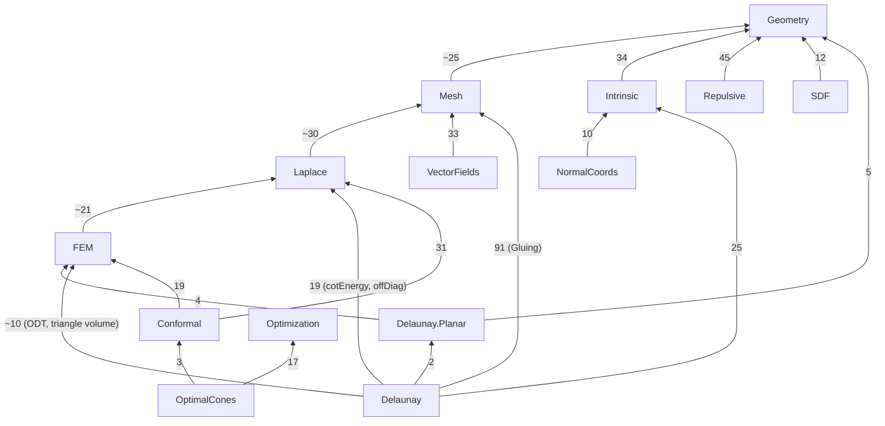

# Library plan: a modular Lean library of discrete differential geometry

Status: **proposal, nothing implemented.** Base: `points-as-tori` @ `156b027` (192 modules,
70 216 lines, 1 430 `[formula: id]` tags, no `sorry`).

**Summary.** Split the 70k lines into a **library `DDG`** (≈ 50k lines, 14 Lake libraries, one per
mathematical topic, plus an umbrella library, in a new package `lean/ddg` that needs only Mathlib) and an
**app layer `DdgProofs`** (≈ 20k lines: oracle bridges, solver/Rust control flow, Cuts,
Developability, reference-code variants) that stays in `lean/proofs` and requires `ddg` and the
oracle. The parts form a 6-level DAG. 17 modules have to be split. The library must not
mention the oracle's `Ddg.*` definitions: about 75 formulas get native ℝ/ℤ definitions, and the
existing `_eq` lemmas become one-way bridges in the app layer. Estimated effort is ≈ 28.5 agent-hours
(≈ 10 Opus, ≈ 18.5 Sonnet) in 6 steps, each ending with a green build. That is ≈ 21 h wall clock with
≤ 3 agents.

How the numbers were obtained: a read-only Lean meta script over the built `.olean`s lists, for
every declaration of every `DdgProofs`/`DdgOracle` module, the constants its type and value use
(24 123 cross-module uses; script in Appendix A; it runs in 10 s). Every "uses" and "nothing
used" claim below comes from that script, not from grepping names. Lazily generated
auxiliary declarations (equation lemmas, `match` splitters) were filtered out as artifacts.

---

## 1. Parts

### What goes in the library and what goes in the app layer

* **Library:** statements about standard mathematical objects (triangles, meshes, Δ-complexes,
  the cotan Laplacian, integrals, metrics, energies) that someone could cite without knowing
  this repository. Definitions are native (ℝ, ℤ, Mathlib types).
* **App (`DdgProofs`):** statements whose subject is a particular implementation:
  * statements about the oracle's `Ddg.*` definitions, and the bridges to them;
  * solver control flow (stop rules, schedules, tolerances, queues, cone merging);
  * reference-code variants (`ref: …cpp`), options that are off by default, "not in the paper" quadratures;
  * results about the papers' own pipelines that are not reusable theory (Variational Cuts flow, Developability on `Ddg.Point`).

### Parts

Sizes count lines of current code; a split module is apportioned by its sections. "Tags" are
`[formula: id]` docstring tags; they move with their theorems.

| # | part (`lean_lib`, namespace root `DDG`) | purpose / main results | lines | tags | depends on (direct) |
|---|---|---|--:|--:|---|
| 1 | **Geometry** `DDG.Geometry` | Euclidean triangles from lengths (law of cosines, Heron, cot); stable evaluation forms (Kahan, `atan2`); plane primitives (`sda`, `dist2`, layouts), signed angles, segment crossing, similarity fit; barycentric lengths and level crossings; ℝ³ vectors and derivatives along motions; rigid-motion invariance (`Σ g = 0`, `Σ x×g = 0`); closest points of segments and triangles (Ericson), conservative advancement | 4 125 | 91 | Mathlib |
| 2 | **Optimization** `DDG.Optimization` | Generic: soft threshold / prox with bounds, exactness of a piecewise-affine Newton step, weak-Wolfe ⇒ `sᵀy>0`, L-BFGS two-loop = BFGS inverse update, 1-Wasserstein on finite pseudometrics. No DDG content, so it can be spun off. | 1 012 | 18 | Mathlib |
| 3 | **Mesh** `DDG.Mesh` | `TriMesh` (simplicial, edge lengths, angles, `Valid`, scaling), Euler characteristic, `Manifold`, orientation/halfedges/twin, discrete Gauss–Bonnet; Δ-complexes as gluing data (`Gluing`) and their combinatorial edge flip | 1 876 | 18 | Geometry |
| 4 | **Laplace** `DDG.Laplace` | Cotan formula, cotan Laplacian (symmetric, PSD, kernel = constants, interior block PD), lumped mass, weighted cotan Laplacian, Dirichlet/Poisson/Neumann problems, Dirichlet-to-Neumann, harmonic extension | 1 305 | 38 | Mesh |
| 5 | **FEM** `DDG.FEM` | Lebesgue integrals over triangles (Beta integral, affine change, area coordinates), P1 Galerkin mass and stiffness, weighted stiffness, conformal energy of a linear map, side fluxes, tilings, connection-Laplacian exponential integrals, heat-method element formulas, attribute transfer (L² normal equations) | 2 210 | 54 | Laplace |
| 6 | **Intrinsic** `DDG.Intrinsic` | Intrinsic triangulations, local theory: diamond layout and unfolding, flipped edge length, angles after a flip, signposts and angle normalization, tracing step and strip intersection, barycentric coordinates and circumcentre from lengths, moving a vertex, removing an inserted or flat vertex by flips, intrinsic mollification | 3 059 | 66 | Geometry |
| 7 | **NormalCoords** `DDG.NormalCoords` | Normal (integer) coordinates: face model, flips (Eq. 3/4), splits, merges, tracing termination, complex model, input-aligned frames | 6 604 | 112 | Intrinsic |
| 8 | **VectorFields** `DDG.VectorFields` | Holonomy of signpost frames, singularity index, discrete Poincaré–Hopf | 549 | 10 | Mesh |
| 9 | **Delaunay.Planar** `DDG.Delaunay.Planar` | Planar Delaunay theory: triangulations of point sets, Lawson flip, termination (lifting), Delaunay's lemma, existence, uniqueness up to cocircularity, `C(n,2)` flip bound, point insertion; encroachment/diametral circle (Ruppert) | 4 088 | 16 | Geometry, FEM (only `FEM/TriangleIntegral`: a triangle as a set and its measure) |
| 10 | **Delaunay** `DDG.Delaunay` | Intrinsic Delaunay: one-diamond criterion (angles ⇔ cot weight ⇔ circumcircle), Rippa, lifting and harmonic-index potentials, piecewise-flat metrics on gluing data, flip algorithm termination, the tolerant flip loop, boundary fans, layer-4 overlays (finitely many triangulations with bounded edges), planar↔intrinsic bridge, **ODT** (Chen–Holst; new module from 3 splits) | 8 749 | 68 | Delaunay.Planar, Intrinsic, FEM, Laplace, Mesh |
| 11 | **Conformal** `DDG.Conformal` | Linearized Yamabe equation, Cherrier formula, Hilbert transform, closing the boundary curve (BFF), cutting to a disk and cone angle sums, conformal energy over an oriented mesh, stereographic projection and Möbius normalization, distortion measures (singular values, quasi-conformal error, log scale), CETM vertex flattening (extended angles, monotonicity, curvature conservation, projective interpolation) | 4 209 | 113 | FEM, Laplace, Mesh |
| 12 | **OptimalCones** `DDG.OptimalCones` | The convex cone-placement problem: KKT ⇔ global minimizer, uniqueness, duality gap certificate (exact and inexact data), semismooth Newton exactness on fixed active sets, closed meshes and area normalization, separation over components, mesh and boundary versions | 3 513 | 76 | Optimization, Conformal |
| 13 | **Repulsive** `DDG.Repulsive` | Tangent-point energies of curves and surfaces: kernels and gradients, discrete energies and differentials, Sobolev–Slobodeckij Gram/inner products, saddle systems and Schur complements, constraints and penalties, Barnes–Hut (energy, adjoint), multigrid coarsening rule, fractional preconditioner order | 6 139 | 230 | Geometry |
| 14 | **SDF** `DDG.SDF` | Signed distance functions (Points as Tori): exact torus SDF, torus fitting from Monge-patch fundamental forms, the reference frame, softmin blend (shift invariance, gradient), Booleans and Lipschitz bounds, marching-cubes interpolation, the 2D circle variant | 2 661 | 50 | Geometry |
| — | **app** `DdgProofs` (stays in `lean/proofs`) | Oracle bridges (`Oracle/*` + new `Oracle/{Intrinsic,NormalCoords,Geometry}`), cone solver/FactorOnce/feedback, Variational Cuts flow, Developability, intrinsic-simplification glue, near-pair quadratures, schedules, reference remesher/Armijo variants, PAT baselines/loss, audits | 20 117 | 469 | all parts + `DdgOracle` |

The library totals ≈ 50 100 lines and ≈ 960 tags.

### DAG

Direct edges only. Every edge points down, and each edge is labelled with the number of distinct
declarations it uses after the fixes in §3.



Levels: 0 = Geometry, Optimization · 1 = Mesh, Intrinsic, Repulsive, SDF · 2 = Laplace,
VectorFields, NormalCoords · 3 = FEM · 4 = Delaunay.Planar, Conformal · 5 = Delaunay,
OptimalCones.

The parts can be isolated. For example, `lake build DDGDelaunayPlanar` compiles only
Geometry/{Triangle, Plane}, FEM/TriangleIntegral and the planar modules on top of Mathlib.
`DDGRepulsive` compiles only Geometry. Lake does **not** enforce boundaries between libraries of
one package, so `scripts/check-lean-dag.py` (step S0) enforces them against `lean/ddg/parts.toml`.

Not done now, but sensible later (see §6):
* move metric triangulations (`Delaunay/Metric`, `MetricGluing`, overlays) from Delaunay down into Intrinsic;
* unify the mesh models: `TriMesh`, `Gluing`, NormalCoords' `Cx`, CETM's `FaceMesh`/`StarFace`;
* unify the two rigid-motion APIs (`Intrinsic.rigid` and `Delaunay.Surface.Rigid`);
* unify the two ℝ³ types (`RC.V3 = Fin 3 → ℝ` and Developability's `Ddg.Point ℝ`).

---

## 2. Module map

Abbreviations in the "act" column:
* **M** = move (`git mv`) unchanged;
* **S** = split; the pieces are separated by "·";
* **O** = de-oracle (native definitions, bridges to the app);
* **A** = app layer;
* **R** = aggregator file, regenerated.

Targets are under `lean/ddg/DDG/` unless they say "app" (then under `lean/proofs/DdgProofs/`).
Rule for splits: the piece with the most importers keeps the old module name until the move step,
so importers are only touched once.

| current (`DdgProofs/…`) | lines | part | act | target (`DDG/…` unless "app") |
|---|--:|---|---|---|
| Audit | 1727 | app | A | app `Audit` (names via rename map) |
| AuditAll | 43 | app | A | app `AuditAll` (+ `DDG` prefix) |
| BoundaryProblem | 328 | OptimalCones | M | OptimalCones/BoundaryProblem |
| Certificate | 925 | OptimalCones | M | OptimalCones/Certificate |
| Closed | 215 | OptimalCones | M | OptimalCones/Closed |
| Components | 421 | OptimalCones | M | OptimalCones/Components |
| ConeFeedback | 215 | app | A | app OptimalCones/ConeFeedback |
| Cotan | 585 | Mesh+Laplace | S | Mesh/TriMesh (structure, side lengths, angles, `Valid`, scaling) · Laplace/Cotan (cotan formula, assembled L, mass) |
| Duality | 308 | OptimalCones | M | OptimalCones/Duality |
| Evaluated | 251 | Geometry+app | S | Geometry/Stable (`atan2`, Kahan area/angle/cot) · app Core/Fields (`gauss_bonnet_fields`, Laplacian-entry form) |
| FactorOnce | 1053 | app | A | app OptimalCones/FactorOnce |
| GaussBonnet | 292 | Mesh+Laplace | S | Mesh/GaussBonnet · `sum_cone_eq_two_pi_eulerChar` → Laplace/Cotan |
| IntegerCoords | 30 | — | R | aggregator → DDG/NormalCoords.lean |
| IntrinsicSimplification | 18 | — | R | aggregator → app |
| MeshProblem | 143 | OptimalCones | M | OptimalCones/MeshProblem (import Laplace, not Bff.Laplace: nothing used) |
| Newton | 577 | Optimization+OptimalCones | S | Optimization/PiecewiseAffine (§ Abstract, `IsPiecewiseAffine`) · OptimalCones/Newton (rest) |
| Optimality | 420 | OptimalCones | M | OptimalCones/Optimality |
| Orientation | 238 | Mesh | M | Mesh/Orientation |
| PointsAsTori | 19 | — | R | aggregator → DDG/SDF.lean |
| Problem | 246 | OptimalCones | M | OptimalCones/Problem |
| RepulsiveCurves | 25 | — | R | aggregator → DDG/Repulsive.lean |
| RepulsiveSurfaces | 25 | — | R | aggregator → DDG/Repulsive.lean |
| SoftThreshold | 542 | Optimization | M | Optimization/SoftThreshold |
| Solver | 1182 | Laplace+app | S | Laplace/Kernel (`mulVec_eq_of_sum_eq`, `sum_eq_zero_of_mulVec_eq`) · app OptimalCones/Solver (rest) |
| Triangle | 344 | Geometry | M | Geometry/Triangle (+ `IsTriangle.swap`, `isTriangle_of_heron_pos` ← Diamond; `cornerAngle_swap` ← Intrinsic.Delaunay) |
| TriangleIntegral | 20 | — | R | aggregator → DDG/FEM.lean |
| Yamabe | 258 | Conformal | M | Conformal/Yamabe |
| Bff/ConformalEnergy | 174 | Conformal | M | Conformal/ConformalEnergy |
| Bff/Curve | 1239 | Conformal | M | Conformal/BoundaryCurve |
| Bff/Cut | 359 | Conformal | M | Conformal/Cut |
| Bff/Laplace | 325 | Laplace+Conformal | S | Laplace/Poisson (Dirichlet/Poisson, DtN, Neumann) · Conformal/Cherrier (linearized G–B, Cherrier, Hilbert transform) |
| Bff/Quality | 1697 | Geometry+Conformal+Intrinsic | S | Geometry/Plane (L101–270: `dot2 sqDist2 dist2 toC sda`, layout) · Geometry/SignedAngle · Geometry/SegmentCrossing · Geometry/SimilarityFit · Conformal/Distortion (singular values, qc error, log scale) · Intrinsic/Mollification |
| Bff/Sphere | 327 | Conformal | M | Conformal/Sphere |
| Cuts/Analytic | 595 | app | A | app |
| Cuts/Crossing | 501 | Geometry+app | S,O | Geometry/Barycentric (level crossing, barycentric lengths, sub-triangle areas, cot; native defs) · app (clamp, oracle bridges) |
| Cuts/Curvature | 383 | app | A | app |
| Cuts/Dirichlet | 817 | Laplace+app | S | Laplace/Dirichlet (§ block products, Dirichlet problem, harmonic extension: 0 oracle refs) · app (rest) |
| Cuts/OnCut | 1131 | app | A | app |
| Cuts/Quantile | 1376 | app | A | app |
| Cuts/Recovery | 284 | app | A | app |
| Cuts/Redistance | 461 | app | A | app (promotion candidate: Hopf–Lax local update) |
| Cuts/Regions | 676 | app | A | app |
| Cuts/Ripple | 344 | app | A | app |
| Cuts/Step | 919 | app | A | app |
| Cuts/Stop | 471 | app | A | app |
| Cuts/VertexLimit | 428 | app | A | app |
| Cuts/Weighted | 397 | Laplace+app | S | Laplace/Weighted (L1–289) · app (§ oracle entries) |
| Delaunay/BoundaryFan | 287 | Delaunay | M | Delaunay/BoundaryFan |
| Delaunay/Complex | 533 | Mesh | M | Mesh/Gluing |
| Delaunay/Encroachment | 200 | Delaunay.Planar | M | Delaunay/Planar/Encroachment |
| Delaunay/Flip | 693 | Mesh | M | Mesh/GluingFlip |
| Delaunay/FlipQueue | 438 | Delaunay | M | Delaunay/FlipQueue |
| Delaunay/FromTriMesh | 224 | Delaunay | M | Delaunay/FromTriMesh |
| Delaunay/Local | 579 | Delaunay | M,O | Delaunay/Local (+ criterion half of Intrinsic.Delaunay); loses oracle via Diamond |
| Delaunay/Metric | 385 | Delaunay | M | Delaunay/Metric |
| Delaunay/PlanarBasic | 587 | Delaunay.Planar | M | Delaunay/Planar/Basic |
| Delaunay/PlanarBridge | 99 | Delaunay | M | Delaunay/PlanarBridge (stays in intrinsic lib) |
| Delaunay/PlanarExistence | 292 | Delaunay.Planar | M | Delaunay/Planar/Existence |
| Delaunay/PlanarFlip | 496 | Delaunay.Planar | M | Delaunay/Planar/Flip |
| Delaunay/PlanarFlipCount | 484 | Delaunay.Planar | M | Delaunay/Planar/FlipCount |
| Delaunay/PlanarInsertion | 687 | Delaunay.Planar | M | Delaunay/Planar/Insertion |
| Delaunay/PlanarLemma | 761 | Delaunay.Planar | M | Delaunay/Planar/Lemma |
| Delaunay/PlanarTermination | 271 | Delaunay.Planar | M | Delaunay/Planar/Termination |
| Delaunay/PlanarUniqueness | 310 | Delaunay.Planar | M | Delaunay/Planar/Uniqueness |
| Delaunay/Potential | 237 | Delaunay | M | Delaunay/Potential |
| Delaunay/Rippa | 214 | Delaunay | M | Delaunay/Rippa |
| Delaunay/Surface/Angle | 242 | Delaunay | M | Delaunay/Surface/Angle |
| Delaunay/Surface/Count | 159 | Delaunay | M | Delaunay/Surface/Count |
| Delaunay/Surface/Fan | 502 | Delaunay | M | Delaunay/Surface/Fan |
| Delaunay/Surface/Finite | 241 | Delaunay | M | Delaunay/Surface/Finite (import Termination, not FlipQueue: nothing used) |
| Delaunay/Surface/FlipEdge | 640 | Delaunay | M | Delaunay/Surface/FlipEdge |
| Delaunay/Surface/FlipFace | 448 | Delaunay | M | Delaunay/Surface/FlipFace |
| Delaunay/Surface/Layout | 375 | Delaunay | M | Delaunay/Surface/Layout |
| Delaunay/Surface/Overlay | 443 | Delaunay | M | Delaunay/Surface/Overlay |
| Delaunay/Surface/Plane | 581 | Delaunay | M | Delaunay/Surface/Plane |
| Delaunay/Surface/Quad | 402 | Delaunay | M | Delaunay/Surface/Quad |
| Delaunay/Surface/Relayout | 219 | Delaunay | M | Delaunay/Surface/Relayout |
| Delaunay/Surface/Segment | 406 | Delaunay | M | Delaunay/Surface/Segment |
| Delaunay/Termination | 780 | Delaunay | M | Delaunay/Termination |
| Developability/Basic | 496 | app | A | app |
| Developability/Combinatorial | 426 | app | A | app |
| Developability/Covariance | 315 | app | A | app |
| Developability/Eig | 225 | app | A | app |
| Developability/Intrinsic | 352 | app | A | app |
| Developability/Invariance | 181 | Geometry | M | Geometry/RigidInvariance (uses nothing of Dev.Vec: pure move) |
| Developability/MaxCovariance | 169 | app | A | app |
| Developability/Optimizer | 160 | Optimization+app | S | Optimization/Wolfe (`weakWolfe_curvature`) · app (oracle line search) |
| Developability/RegularCone | 387 | app | A | app |
| Developability/Remesh | 191 | app | A | app (imports Geometry/Triangle for `isTriangle_of_heron_pos`) |
| Developability/Subdivision | 188 | app | A | app |
| Developability/Vec | 382 | app | A | app |
| Developability/Width | 311 | app | A | app |
| IntegerCoords/Chords | 278 | NormalCoords | M | NormalCoords/Chords |
| IntegerCoords/Complex/Basic | 318 | NormalCoords | M | NormalCoords/Complex/Basic |
| IntegerCoords/Complex/Extract | 141 | NormalCoords | M | NormalCoords/Complex/Extract |
| IntegerCoords/Complex/Flip | 927 | NormalCoords | M | NormalCoords/Complex/Flip |
| IntegerCoords/Complex/Labels | 254 | NormalCoords | M | NormalCoords/Complex/Labels |
| IntegerCoords/Complex/Merge | 193 | NormalCoords | M | NormalCoords/Complex/Merge |
| IntegerCoords/Complex/Quad | 261 | NormalCoords | M | NormalCoords/Complex/Quad |
| IntegerCoords/Complex/QuadAdm1 | 40 | NormalCoords | M | NormalCoords/Complex/QuadAdm1 |
| IntegerCoords/Complex/QuadAdm2 | 38 | NormalCoords | M | NormalCoords/Complex/QuadAdm2 |
| IntegerCoords/Complex/QuadCount | 127 | NormalCoords | M | NormalCoords/Complex/QuadCount |
| IntegerCoords/Complex/QuadFlip | 28 | NormalCoords | M | NormalCoords/Complex/QuadFlip |
| IntegerCoords/Complex/QuadOuterIL | 20 | NormalCoords | M | NormalCoords/Complex/QuadOuterIL (keep the 4-way split: parallel build) |
| IntegerCoords/Complex/QuadOuterJK | 20 | NormalCoords | M | NormalCoords/Complex/QuadOuterJK |
| IntegerCoords/Complex/QuadOuterKI | 20 | NormalCoords | M | NormalCoords/Complex/QuadOuterKI |
| IntegerCoords/Complex/QuadOuterLJ | 20 | NormalCoords | M | NormalCoords/Complex/QuadOuterLJ |
| IntegerCoords/Complex/QuadSide | 43 | NormalCoords | M | NormalCoords/Complex/QuadSide |
| IntegerCoords/Complex/SplitAtCrossing | 250 | NormalCoords | M | NormalCoords/Complex/SplitAtCrossing |
| IntegerCoords/Complex/Trace | 340 | NormalCoords | M | NormalCoords/Complex/Trace |
| IntegerCoords/FaceModel | 868 | NormalCoords | M,O | NormalCoords/FaceModel |
| IntegerCoords/FaceSplit | 559 | NormalCoords | M,O | NormalCoords/FaceSplit |
| IntegerCoords/Flip | 211 | NormalCoords | M | NormalCoords/Flip |
| IntegerCoords/Formulas | 303 | NormalCoords+app | S,O | NormalCoords/Formulas (native copy of the oracle's 250-line integer defs) · app Oracle/NormalCoords (`rfl` bridges) |
| IntegerCoords/Frames/Angle | 219 | NormalCoords | M | NormalCoords/Frames/Angle |
| IntegerCoords/Frames/Input | 316 | NormalCoords | M | NormalCoords/Frames/Input |
| IntegerCoords/Frames/Inserted | 147 | NormalCoords | M | NormalCoords/Frames/Inserted |
| IntegerCoords/Frames/Wedge | 151 | NormalCoords | M | NormalCoords/Frames/Wedge |
| IntegerCoords/Recover | 121 | NormalCoords | M | NormalCoords/Recover (uses Geometry/Barycentric) |
| IntegerCoords/SplitAtCrossing | 375 | NormalCoords | M | NormalCoords/SplitAtCrossing |
| IntegerCoords/SplitEdge | 69 | NormalCoords | M | NormalCoords/SplitEdge |
| IntegerCoords/Strip | 152 | Intrinsic | M | Intrinsic/Strip |
| IntegerCoords/Transfer | 281 | FEM | M | FEM/Transfer |
| IntegerCoords/VertexRemoval | 224 | Intrinsic | M | Intrinsic/VertexRemoval |
| Intrinsic/AppsAmrVector | 105 | VectorFields | M | VectorFields/Holonomy |
| Intrinsic/Barycentric | 627 | Intrinsic+app | M,O | Intrinsic/Barycentric · `_eq` bridges → app Oracle/Intrinsic |
| Intrinsic/Delaunay | 458 | Intrinsic+Delaunay+app | S,O | Intrinsic/FlipAngles (`quad_angle_sum`, `flip_angle_i/j`, `flip_convex`, `flip_angle_sums`) · Delaunay/Local (cotan-weight criterion, `offDiag_*`) · app (`_eq` bridges) |
| Intrinsic/Diamond | 866 | Intrinsic+Geometry+app | M,O | Intrinsic/Diamond (native `diamondX`=`layoutX`…) · plane lemmas → Geometry/Plane · `_eq` bridges → app |
| Intrinsic/Move | 558 | Intrinsic+Delaunay+app | S,O | Intrinsic/Move (move length/area, circumcentre vector) · Delaunay/ODT (§ `it-odt-update`) |
| Intrinsic/Signpost | 288 | Intrinsic+app | M,O | Intrinsic/Signpost |
| Intrinsic/SingularityIndex | 444 | VectorFields | M | VectorFields/PoincareHopf |
| Intrinsic/Trace | 261 | Intrinsic+app | M,O | Intrinsic/Trace |
| IntrinsicApps/HeatFem | 168 | FEM | M | FEM/Heat |
| IntrinsicSimplification/Curvature | 206 | Conformal | M | Conformal/CETM/Curvature |
| IntrinsicSimplification/Flatten | 329 | Conformal | M | Conformal/CETM/Flatten |
| IntrinsicSimplification/Interpolation | 157 | Conformal | M | Conformal/CETM/Interpolation |
| IntrinsicSimplification/Monotone | 385 | Conformal | M | Conformal/CETM/Monotone |
| IntrinsicSimplification/Operators | 411 | app | A | app (imports Intrinsic/Barycentric: nothing used) |
| IntrinsicSimplification/Oracle | 77 | app | A | app |
| IntrinsicSimplification/Removal | 360 | Intrinsic | M,O | Intrinsic/FlatVertexRemoval (one oracle use: `Ddg.barycentric`) |
| IntrinsicSimplification/Transport | 196 | app | A | app |
| IntrinsicSimplification/Wasserstein | 212 | Optimization | M | Optimization/Wasserstein |
| IntrinsicSimplification/Wrap | 100 | app | A | app |
| Oracle/Mesh | 246 | app | A | app Oracle/Mesh |
| Oracle/Problem | 501 | app | A | app Oracle/Problem |
| Oracle/Regularized | 366 | app | A | app Oracle/Regularized |
| Oracle/Scalar | 343 | app | A | app Oracle/Scalar (imports Optimization/PiecewiseAffine) |
| Oracle/Unbounded | 483 | app | A | app Oracle/Unbounded |
| PointsAsTori/Apps | 264 | SDF | M | SDF/Operations |
| PointsAsTori/Baselines | 205 | app | A | app |
| PointsAsTori/Basic | 167 | SDF | M | SDF/Basic |
| PointsAsTori/Blend | 425 | SDF | M | SDF/Blend |
| PointsAsTori/Features | 203 | SDF | M | SDF/Features (Torus uses `frameS`, `pickU`, `refFrame_spec`) |
| PointsAsTori/Fitting | 656 | SDF | M | SDF/MongeFit (import Basic, not Features: nothing used) |
| PointsAsTori/Loss | 50 | app | A | app |
| PointsAsTori/Pat2d | 175 | SDF | M | SDF/Circle2d (import Basic, not Loss: nothing used) |
| PointsAsTori/Torus | 771 | SDF | M | SDF/Torus |
| RepulsiveCurves/BarnesHutAdjoint | 276 | Repulsive | M | Repulsive/Curves/BarnesHutAdjoint |
| RepulsiveCurves/Basic | 346 | Geometry+Repulsive | S | Geometry/Vec3 (norm, edge quantities, derivatives) · Repulsive/Curves/DualLengths |
| RepulsiveCurves/Ccd | 127 | Geometry | M | Geometry/Advancement |
| RepulsiveCurves/ClosestPoints | 1667 | Geometry | M | Geometry/ClosestPoints |
| RepulsiveCurves/Constraints | 260 | Repulsive | M | Repulsive/Curves/Constraints |
| RepulsiveCurves/Energy | 552 | Repulsive | M | Repulsive/Curves/Energy (imports Geometry/RigidInvariance) |
| RepulsiveCurves/Gram | 891 | Repulsive | M | Repulsive/Curves/Gram |
| RepulsiveCurves/Hierarchy | 248 | Repulsive | M | Repulsive/Curves/Hierarchy |
| RepulsiveCurves/Kernel | 129 | Repulsive | M | Repulsive/Curves/Kernel |
| RepulsiveCurves/KernelGradient | 231 | Repulsive | M | Repulsive/Curves/KernelGradient |
| RepulsiveCurves/Multigrid | 140 | Repulsive | M | Repulsive/Curves/Multigrid |
| RepulsiveCurves/NearPair | 326 | app | A | app (not in the paper) |
| RepulsiveCurves/NearPairSecond | 243 | app | A | app (options off by default) |
| RepulsiveCurves/Penalties | 205 | Repulsive | M | Repulsive/Curves/Penalties |
| RepulsiveCurves/Saddle | 503 | Repulsive | M | Repulsive/Curves/Saddle |
| RepulsiveCurves/Schedule | 208 | app | A | app |
| RepulsiveSurfaces/BarnesHut | 237 | Repulsive | M | Repulsive/Surfaces/BarnesHut |
| RepulsiveSurfaces/Basic | 215 | Repulsive | M | Repulsive/Surfaces/Basic |
| RepulsiveSurfaces/Ccd | 64 | Geometry | M | Geometry/AdvancementPairs |
| RepulsiveSurfaces/Constraints | 241 | Repulsive | M | Repulsive/Surfaces/Constraints |
| RepulsiveSurfaces/Energy | 330 | Repulsive | M | Repulsive/Surfaces/Energy |
| RepulsiveSurfaces/Geometry | 130 | Repulsive | M | Repulsive/Surfaces/Geometry |
| RepulsiveSurfaces/Kernel | 157 | Repulsive | M | Repulsive/Surfaces/Kernel |
| RepulsiveSurfaces/Metric | 578 | Repulsive | M | Repulsive/Surfaces/Metric |
| RepulsiveSurfaces/Optimize | 128 | Optimization | M | Optimization/LBFGS |
| RepulsiveSurfaces/Penalties | 329 | Repulsive | M | Repulsive/Surfaces/Penalties |
| RepulsiveSurfaces/Precond | 184 | Repulsive | M | Repulsive/Surfaces/Precond |
| RepulsiveSurfaces/Remesh | 164 | app | A | app (reference-code formulas) |
| RepulsiveSurfaces/Saddle | 263 | Repulsive | M | Repulsive/Surfaces/Saddle |
| RepulsiveSurfaces/Step | 54 | app | A | app (reference's Armijo variant) |
| TriangleIntegral/Basic | 447 | FEM | M | FEM/TriangleIntegral |
| TriangleIntegral/BetaExp | 315 | FEM | M | FEM/BetaExp |
| TriangleIntegral/Fem | 709 | FEM+Delaunay | S | FEM/Elements · Delaunay/ODT (§ `it-odt-interpolation-error`, L443–573) |
| TriangleIntegral/Flux | 144 | FEM | M | FEM/Flux |
| TriangleIntegral/Tiling | 446 | FEM+Delaunay | S | FEM/Tiling · Delaunay/ODT (§ Odt, L153–320) |

---

## 3. Bad edges

These are current edges that would violate the DAG, found from the used declarations (Appendix A).
"Nothing used" means no declaration of the imported module is referenced: the import only
supplies what that module itself imports.

| # | importer → imported (current) | declarations actually used | fix |
|---|---|---|---|
| 1 | Orientation, GaussBonnet, SingularityIndex, Bff.*, Delaunay.FromTriMesh, Cuts.* → **Cotan** (defines `TriMesh`) | `TriMesh`, `.Valid(.ab/.bc/.ca/.tri)`, `.a .b .c .la .lb .lc`, `.angleA–C`, `.angle*_scale`, `.mk` | Split `Cotan`: structure + per-face quantities + scaling → Mesh/TriMesh |
| 2 | GaussBonnet → Cotan | `laplacian`, `laplacian_vecMul_one`, only in `sum_cone_eq_two_pi_eulerChar` | Move that theorem to Laplace/Cotan |
| 3 | Evaluated → GaussBonnet, Cotan | `gauss_bonnet`, `angleDefect`, `geodesicCurvature`, `Manifold`, `laplacian`, `offDiag`, `cotOpp` | Split: `atan2` and Kahan forms → Geometry/Stable; curvature fields → app Core/Fields |
| 4 | Intrinsic.Diamond, TriangleIntegral.{Basic,Fem,Flux,Tiling}, IntegerCoords.Chords, Delaunay.{Local,Planar*,PlanarBridge}, Intrinsic.*, IS.{Operators,Removal} → **Bff.Quality** | `sda`, `dist2`, `sqDist2`, `dot2`, `toC`, `layoutX/Y`, `layout_isometric`, `sda_layout`, `sda_rotate`, `sda_swap_left/right`, `sda_sq_mul_four`, `abs_sda_eq_two_mul_triArea`, `dist2_sq`, `sqDist2_nonneg` (all in L101–270) | Split `Quality`: L101–270 → Geometry/Plane; nobody outside BFF uses the rest |
| 5 | Bff.Quality → Evaluated | `atan2` | Geometry/Stable (#3) |
| 6 | **Intrinsic.Diamond → Oracle.Scalar** (+ DdgOracle) | `Oracle.instScalarReal`, `triArea_eq`, `two_eq`, `zero_eq`; `Ddg.diamondX/H`, `flipArea1/2`, `flipConvex`, `flippedLength(FromLengths)`, `unfoldApex`, `triArea` | De-oracle: native defs (e.g. `diamondX` is `layoutX a c b` by the existing `diamondX_eq_layoutX`); the `_eq` lemmas become app bridges |
| 7 | Bff.ConformalEnergy, TriangleIntegral.Fem, Delaunay.{PlanarBridge,Local}, Intrinsic.Barycentric → Intrinsic.Diamond as a utility | `dist2_comm`, `dist2_nonneg`, `dist2_sq'`, `isTriangle_of_sda_ne`, `IsTriangle.swap` (also used by Delaunay.{Metric,Potential,Rippa,Termination}); Developability.Remesh: `isTriangle_of_heron_pos` | Move to Geometry/Plane and Geometry/Triangle |
| 8 | Delaunay.{FlipQueue,FromTriMesh,Metric,Termination,Local}, Intrinsic.Signpost → Intrinsic.Delaunay | `cornerAngle_swap` (11 users) | Geometry/Triangle |
| 9 | Intrinsic.Signpost → Intrinsic.Delaunay | `flip_angle_sums` | Split Intrinsic.Delaunay: flip-angle half → Intrinsic/FlipAngles; criterion half → Delaunay/Local; `_eq` → app |
| 10 | Intrinsic.{Barycentric,Trace}, IntegerCoords.Recover, Cuts.Redistance → Cuts.Crossing | `baryLength2_eq`, `baryLength_eq`, `baryLength_eq_dist`, `baryLength2_eq_norm_sq`, `baryLength_eq_norm`; `Ddg.crossingParam` | Geometry/Barycentric with native defs; clamp and oracle parts stay in app Cuts |
| 11 | Bff.Laplace, BoundaryProblem, Cuts.Dirichlet → **Solver** | `Solver.mulVec_eq_of_sum_eq`, `Solver.sum_eq_zero_of_mulVec_eq` | Laplace/Kernel |
| 12 | Bff.Laplace → Yamabe, Bff.Curve | `conformalScale`, `hasDerivAt_angleSum_conformalScale`, `hilbertVector*`, `loopConformalEnergy`, `sum_hilbertRhs_vertices`; only in `hasDerivAt_geodesicCurvature_conformalScale` and `hilbertTransform_cotan` | Split: Poisson/DtN/Neumann → Laplace/Poisson; conformal sections → Conformal/Cherrier |
| 13 | **TriangleIntegral.Fem → Cuts.Weighted** | `weightedLaplacian`, `weightedLaplacian_isSymm`, `dotProduct_weightedLaplacian_mulVec`, `faceMean` | Split Weighted: L1–289 → Laplace/Weighted; the oracle entries → app |
| 14 | TriangleIntegral.Fem → IntrinsicApps.HeatFem | `divergenceCorner`, `galerkinForm` | Move HeatFem → FEM/Heat |
| 15 | **TriangleIntegral.{Fem,Tiling} → Intrinsic.Move** | `nsq`, `odtEnergy`, `toDual(_apply)`, `circumVec`, `odtEnergy_step_le`, `starArea`, `Ddg.odtDisplacement` | New Delaunay/ODT ← Move § `it-odt-update` + Fem § Chen–Holst + Tiling § Odt |
| 16 | **TriangleIntegral.Tiling → IntegerCoords.Transfer** | `bdet`, `pieceMass` | Move Transfer → FEM/Transfer (it is Mathlib-only) |
| 17 | **RepulsiveCurves.Energy → Developability.Invariance** | `Dev.Positions`, `rotX/Y/Z`, `rot_hasDerivAt`, `rotY_hasDerivAt`, `sum_grad_eq_zero`, `sum_cross_grad_eq_zero` | Move Invariance → Geometry/RigidInvariance. It uses nothing from Dev.Vec, so this is a pure move |
| 18 | RS.*, PAT.* → RepulsiveCurves.Basic | `RC.V3`, `vnorm*`, `unit_dot_self`, `dot_self_nonneg`, `orth_*`, `proj`, `hasDerivAt_{dot,cross,unit,vnorm,len,tangent}`, `len`, `tangent`, `sgn` | Split RC.Basic → Geometry/Vec3 (all but the dual lengths) |
| 19 | RS.Ccd → RC.Ccd; RC.ClosestPoints → RC.Ccd | `advance_safe`, `primDist(_lipschitz)`, `primPoint`, `Weights` | Geometry/{Advancement, AdvancementPairs, ClosestPoints} |
| 20 | IS.Removal → IntegerCoords.VertexRemoval, Intrinsic.Barycentric | `FlatStar(.exists_flippable/.inner/.outer)`; `barycentric_eq/_unique`, `sda_split` | VertexRemoval and Removal → Intrinsic |
| 21 | NormalCoords (≈ 20 modules) → `DdgOracle.IntegerCoords.Formulas` | ≈ 30 integer definitions (`cornerCoord`, `faceValid`, `flipNormal`, `nPlus/nMinus`, `emanating`, `traceStep`, `Decoded`, `Region`, `Pt`, `Step`, …) | Copy the 250-line formula file natively into NormalCoords/Formulas; app bridges are `rfl` (the definitions are pure ℤ/ℕ code) |
| 22 | IntegerCoords.Frames.Input → Intrinsic.Signpost (+ `Ddg.angleScale`, `signpostUpdate`) | `angleScale_{interior,boundary,pos}`, `signpost_fold_{boundary,no_wrap}` | Allowed edge NormalCoords → Intrinsic, once Signpost is de-oracled |
| 23 | Oracle.Scalar → Newton | `IsPiecewiseAffine` | Optimization/PiecewiseAffine |
| 24 | PAT.Torus → PAT.Features | `frameS`, `frameT`, `pickU`, `refFrame_spec` | Features → SDF. Fitting→Features and Pat2d→Loss use nothing: re-point them at Basic |
| 25 | Hidden oracle dependence in library code: RC.Energy (`Oracle.four_eq`), RC.Gram/RS.Energy/RS.Metric/Fem (`two_eq`, `three_eq`), RS.Metric (`Ddg.instOfNatScalar`) | the global `@[simp]` lemmas `Oracle.{one..four}_eq` and the oracle's numeral instance reach non-oracle files through transitive imports | Remove the import and repair the few proofs. Make `Oracle.*_eq` `scoped` in the app |
| 26 | Imports where nothing is used: MeshProblem → Bff.Laplace, Cuts.Dirichlet → Cuts.Weighted, Delaunay.Surface.Finite → FlipQueue, Surface.{Plane,Layout} → Intrinsic.Diamond, Surface.Angle → Intrinsic.Delaunay, PlanarBasic → TriangleIntegral.Basic (PlanarTermination does use it: `triangle`, `D`, `triangle_eq_convexHull`, `volume_real_triangle`), IS.Operators → Intrinsic.Barycentric | — | Import the module that is actually needed |
| 27 | Oracle.Problem → Developability.Intrinsic | only `Ddg.sumTo.match_1.splitter`, which is generated lazily in the first module that needs it | Artifact; disappears when the modules are separated |

Edges that stay because they are intentional and inside one part or the app layer:
* RS → RC (`gradient_identities_of_curves`, `posSemidef_of_form`, `chord_least_norm`, `cross_vnorm_sq`), inside Repulsive;
* IS.Flatten → Yamabe, inside Conformal;
* ConeFeedback → Cuts.Quantile and Cuts.* → Oracle.*, inside the app layer.

---

## 4. Packaging

| option | isolation enforced by | Mathlib | cost | verdict |
|---|---|---|---|---|
| A. one package `lean/proofs`, one `lean_lib` per part + the app lib | a script only (Lake allows any module of a package to import any other) | one | lowest | fallback |
| **B. two packages in this repo:** `lean/ddg` (library: 14 part libs + umbrella, Mathlib only) and `lean/proofs` (app; `require ddg from "../ddg"` and the oracle) | **Lake for library ⊥ app/oracle** (`cd lean/ddg && lake build` cannot see them); a script for the part DAG | one rev, shared workspace; standalone builds symlink `.lake/packages` | +1 h | **recommended** |
| C. one package per part (15 packages) | Lake per part | 15 manifests in lockstep | high, and every Mathlib bump touches 15 manifests | no |
| D. separate repositories | Lake | per repo | highest | only at publication: extract `lean/ddg` with `git filter-repo` path renames, which keeps history across the `git mv`s |

Reasons for B:
* The publishable boundary becomes physical and is checked by the build itself.
* The library never gets the oracle into its manifest.
* App edits stop rebuilding the library.
* Extracting the library into its own repository later is a directory copy.

**Layout and lakefile (sketch).**

```toml
# lean/ddg/lakefile.toml
name = "ddg"
defaultTargets = ["DDG"]
[leanOptions]
autoImplicit = false
relaxedAutoImplicit = false
[[require]]
name = "mathlib"
git = "https://github.com/leanprover-community/mathlib4"
rev = "v4.34.1"          # same rev as lean/proofs; bump both together
[[lean_lib]]
name = "DDG"             # umbrella: DDG.lean imports the part roots
[[lean_lib]]
name = "DDGGeometry"
roots = ["DDG.Geometry"]
globs = ["DDG.Geometry.+"]
# … one block per part: DDGOptimization, DDGMesh, DDGLaplace, DDGFEM, DDGIntrinsic,
#   DDGNormalCoords, DDGVectorFields, DDGDelaunayPlanar, DDGDelaunay, DDGConformal,
#   DDGOptimalCones, DDGRepulsive, DDGSDF
```

`lean/ddg/parts.toml` lists the direct dependencies of each part, as in the §1 table.
`scripts/check-lean-dag.py` fails if:
* a file under `DDG/<P>/` imports `DDG.<Q>` with `Q` outside the closure of `P`'s dependencies;
* anything under `lean/ddg` imports `DdgProofs` or `DdgOracle`.

**Namespaces.** Name declarations by mathematical object, not by part or directory. A later move
of a module between parts then changes only import paths, never declaration names.

| now | library | note |
|---|---|---|
| `DdgProofs` | `DDG` | root, step S1, for all files (app included) |
| `DdgProofs.Delaunay.Gluing`, `.MetricGluing` | `DDG.Gluing`, `DDG.MetricGluing` | Gluing moves down to Mesh |
| `DdgProofs.IntegerCoords` | `DDG.NormalCoords` | `Strip`, `FlatStar` → `DDG.Intrinsic.*`; `bdet`, `pieceMass` → `DDG.FEM.*` |
| `DdgProofs.TriangleIntegral` | `DDG.FEM` | |
| `RC.V3`, `RC.vnorm`, … (the Basic part) | `DDG.V3`, `DDG.vnorm` | unqualified `V3` inside `namespace DDG.RC` keeps resolving |
| `Dev.Positions`, `Dev.rot*` | `DDG.Positions`, `DDG.rot*` | |
| `Cuts.baryLength*`, `Intrinsic.dist2_comm`, `Intrinsic.cornerAngle_swap`, `IsTriangle.swap` | `DDG.*` (Geometry) | |
| `RC`, `RS`, `PAT`, `Intrinsic`, `Delaunay`, `Delaunay.Planar` | kept in phase 1 | optional polish in S6: `DDG.Repulsive.Curve`/`.Surface`, `DDG.SDF` |

No deprecation aliases: nothing outside this repository consumes the names yet. Every rename goes
through one generated map (old → new full name), which is applied to the app, `Audit.lean`
(≈ 1 650 `#print axioms` lines), README, SURVEY and CITED.

**Formula ids, checks and audits.**
* **`[formula: id]` tags** stay in the docstrings of the library theorems. They are plain
  docstring text, and the library README gets a paragraph explaining them. The 1 430 tags keep
  their ids, and the 765 Rust tags reference ids only, so the Rust code needs no change.
* **`scripts/check-formulas.sh`** changes in three places:
  * the `find` gets a second root, `lean/ddg`;
  * `--build` first runs `cd lean/ddg && lake build`, which also proves the library is isolated, and then builds the app and runs the audit;
  * `--audit-all` adds `DDG` to the module-prefix filter in `AuditAll.lean`.
* **`CITED.md`** and **`FORMALIZATION-SURVEY.md`** stay in `lean/proofs`, since they track the
  ids of the Rust formulas. Their path mentions (161 in `lean/**/*.md`) are rewritten from the
  move map. Before publication, generate a library-facing "cited, not proved" page from `CITED.md`.
* **Audits** (`Audit.lean`, `AuditAll.lean`) stay in the app. They import both packages, so they
  cover library and app together.
* **Rust and docs** contain 38 path or Lean-name mentions (crates, CLAUDE.md, README, ROADMAP,
  scripts), which are rewritten from the move map. From then on they should cite ids, not paths.

---

## 5. Migration plan

Every step ends with a green build, checked by:
* `lake build` in both packages;
* `scripts/check-formulas.sh --build`, which includes the audit;
* `check-lean-dag.py`, from step S4 on.

Splits happen in place before any move. Moves are scripted `git mv`s. Work happens on a new
branch `lean-library`, after `points-as-tori` is merged, with other Lean work frozen during S1 and S4.

| step | content | agents (model, h) | runs in parallel with |
|---|---|---|---|
| **S0** tooling | Add to `scripts/`:<br>• `lean-uses.lean` (Appendix A: declaration-level edges);<br>• `check-lean-dag.py`;<br>• `lean-move.py`, which reads a TSV (old module, new module, name renames) and does the `git mv`, rewrites imports in both packages, applies the name renames, and rewrites `.md`/`.rs` path mentions.<br>Measure the full build time. | Sonnet 1.5 | — |
| **S1** root rename | `DdgProofs` → `DDG` as the namespace in all 192 files, `Audit.lean` and the docs. Module names are unchanged. One commit, then a full rebuild. | Sonnet 2 | — |
| **S2a** splits: base | `Bff.Quality` (5 pieces), `Evaluated`, `RC.Basic`, `Cotan`, the GaussBonnet corollary, the Solver lemmas, the abstract part of `Newton`, `Dev.Optimizer`, `Cuts.Weighted`, `Cuts.Dirichlet`, `Bff.Laplace`; the import fixes of #24 and #26 | Sonnet 3 | S2b, S2c |
| **S2b** splits: intrinsic/FEM | `Intrinsic.Delaunay` (3 ways), the Diamond utility lemmas → Geometry, new `Delaunay/ODT` from Move/Fem/Tiling, the geometry piece of `Cuts.Crossing`, HeatFem/Transfer/VertexRemoval imports | Opus 4 | S2a, S2c |
| **S2c** de-oracle NormalCoords | Native `NormalCoords/Formulas` (copy), `rfl` bridges in app `Oracle/NormalCoords`, re-point `open Ddg.IntegerCoords` | Sonnet 3 | S2a, S2b |
| **S3** de-oracle Intrinsic | About 45 ℝ formulas get native defs: `diamondX/H`, `flippedLength`, `flipArea*`, `cotanWeight`, `delaunayExcess`, `angleScale`, `signpostUpdate`, `reduceFullTurn`, `barycentric`, `circumcenterBary`, `cornerDistances`, `movedLength`, `axisCrossing*`, `crossingParam`, `baryLength*`, … The `_eq` lemmas become one-way bridges in app `Oracle/Intrinsic`. Drop `Oracle.Scalar` from library imports and fix the proofs that relied on its simp lemmas (#25). | Opus 6 | S3′ |
| **S3′** hidden oracle uses | Repulsive, SDF, FEM: remove transitive oracle imports, fix numerals and simp calls; make `Oracle.*_eq` scoped | Sonnet 2 | S3 |
| **S4** package and moves | Create `lean/ddg` (lakefile, `parts.toml`). Copy the manifest entries for mathlib and its dependencies from `lean/proofs` by hand, and symlink `.lake/packages` (no Mathlib rebuild). Add `require ddg` to `lean/proofs`; registering it in the manifest is a targeted `lake update ddg` or a hand edit, **needs your go-ahead**. Then move in DAG order:<br>① Geometry + Optimization<br>② Mesh<br>③ Laplace + Intrinsic + VectorFields<br>④ FEM + NormalCoords<br>⑤ Delaunay.Planar + Delaunay + Conformal<br>⑥ OptimalCones + Repulsive + SDF<br>Green after each batch. | Sonnet 5 (one agent, sequential: every batch rewrites shared imports) | — |
| **S5** docs and tooling | Library README (per part, skeleton from the module docstrings); app README trimmed to the Rust ↔ Lean mapping; `check-formulas.sh` roots; AuditAll prefix; the 38 + 161 path rewrites | Sonnet 2 | — |
| | **total** | **≈ 28.5 agent-h** (Opus ≈ 10, Sonnet ≈ 18.5); wall clock ≈ 21 h plus build waits | |
| S6 *(optional, before publishing)* | • namespace polish;<br>• metric triangulations moved to Intrinsic;<br>• mesh-model, rigid-motion and V3 unification;<br>• Developability promoted to the library (re-base on `Fin 3 → ℝ`: 15–25 h by itself);<br>• Hopf–Lax update (Cuts.Redistance) promoted;<br>• doc-gen4, CI with Mathlib cache, `CITATION.cff`, extraction to its own repo | Opus 20–40 | |

**Risks.**
* **Namespace churn.** The Rust code references ids, so it is safe. `Audit.lean`, the docs and
  38 Rust/doc mentions all go through one generated rename map. Without aliases, an omission
  shows up as a build or audit error, not as silent drift.
* **Compile time.** S1 and batch ① touch `Triangle.lean`, so the whole package rebuilds
  (measure in S0). Afterwards app edits no longer rebuild the library. Keep the four
  `QuadOuter*` files separate, since that split exists so they build in parallel.
* **Hidden dependencies.** Some proofs lean on transitive imports or on the global oracle simp
  lemmas (#25). Removing an import can break a handful of proofs; each fix costs a build cycle,
  which is budgeted in S3 and S3′.
* **Mathlib version.** Both packages must pin the same rev in one workspace. Never run
  `lake update` on mathlib. The manifest for `lean/ddg` is created by copying entries, not by
  resolving.
* **Lake does not enforce the part DAG.** The DAG checker runs inside `check-formulas.sh`, so a
  violation fails the same gate as a missing proof.
* **Clean room.** Cuts and Developability, clean-room from GPL references, stay in the app layer.
  The library contains none of that material.

---

## 6. Open decisions

| # | question | recommendation |
|---|---|---|
| 1 | Library name and namespace | `DDG` (package `ddg`, directory `lean/ddg`). Alternative: `DiscreteDifferentialGeometry`. Caveat: `DDG.cornerAngle` (library, ℝ) next to the oracle's `Ddg.cornerAngle` (generic) is easy to confuse. Renaming the oracle's namespace to `DdgOracle` would help (S6, mechanical). |
| 2 | Is the optimization theory in scope? | Yes, as two parts. `Optimization` is generic and Mathlib-only, so it can be spun off. `OptimalCones` is the convex cone problem, built on Conformal. The solver, FactorOnce and feedback modules stay in the app layer. |
| 3 | Do paper-specific results stay in this repo? | Yes, in the app layer `DdgProofs`: Cuts flow, Developability, oracle bridges, solver control, schedules, reference-code variants. The library is the ≈ 50k lines of reusable theory. |
| 4 | Should library statements mention the oracle's `Ddg.*`? | No. Use native definitions plus bridges in the app (S2c + S3 ≈ 9 h). The cheaper alternative is to let the library depend on the oracle's Mathlib-free formula layer, which saves ≈ 8 h but makes the published statements use `Ddg.Scalar`-generic definitions under a scoped ℝ instance. |
| 5 | Packaging | Option B: two packages in this repo (§4). A separate repo only when publishing. |
| 6 | Keep `[formula: id]` tags in the published library? | Keep them in the docstrings and explain them in the README. Moving them onto app restatements would add about 960 restatements for no gain. |
| 7 | Namespace of the app layer | Also `DDG` (S1). After that, moving a module between app and library never renames anything. Alternative: keep `DdgProofs` for the app, but then every library move needs `open DDG` edits in the app. |
| 8 | Metric triangulations (`Delaunay/Metric`, `MetricGluing`, overlays): Delaunay or Intrinsic? | Leave them in Delaunay for now, since nothing else uses them. Revisit when NormalCoords' `Cx` is unified with `Gluing` (S6). Object-based names make the later move cost only import changes. |
| 9 | Planar Delaunay as its own library? | Yes: `DDG.Delaunay.Planar` needs only Geometry and FEM/TriangleIntegral. |
| 10 | License | MIT, the repository's license. Add `CITATION.cff` and credit the papers (and the MIT reference code) per part in the library README. |
| 11 | Mathlib policy after publication | Decide then. Until then the library is pinned together with the app. |

---

## Appendix A: declaration-level dependency extractor

Run it with `cd lean/proofs && lake env lean <file>`. It takes about 10 s on built oleans.

```lean
import DdgProofs
open Lean

#eval show CoreM Unit from do
  let env ← getEnv
  let header := env.header
  let isOurs (m : Name) : Bool := (`DdgProofs).isPrefixOf m || (`DdgOracle).isPrefixOf m
  let h ← IO.FS.Handle.mk "uses.tsv" .write
  for i in [0:header.moduleNames.size] do
    let modName := header.moduleNames[i]!
    if !isOurs modName then continue
    for c in header.moduleData[i]!.constNames do
      let some ci := env.find? c | continue
      for u in ci.getUsedConstantsAsSet do
        if let some j := env.getModuleIdxFor? u then
          let m2 := header.moduleNames[j.toNat]!
          if m2 != modName && isOurs m2 then
            h.putStrLn s!"{modName}\t{c}\t{m2}\t{u}"
```

Each output line is `module  declaration  used-module  used-constant`. Aggregate it by part
pair, and drop `.eq_N`, `.match_N`, `_proof_N` and `splitter` names, which are artifacts.
